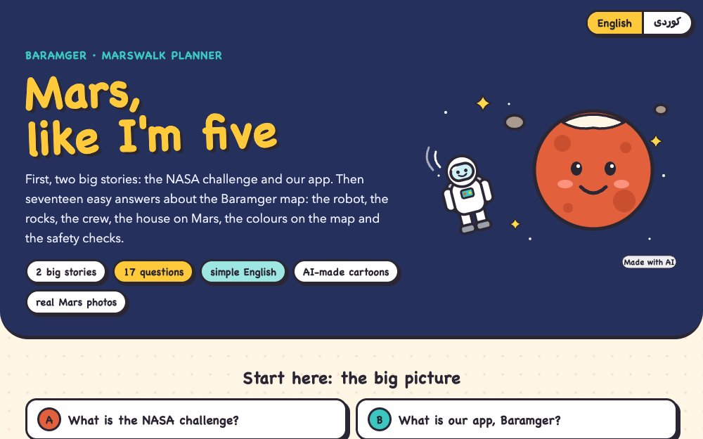
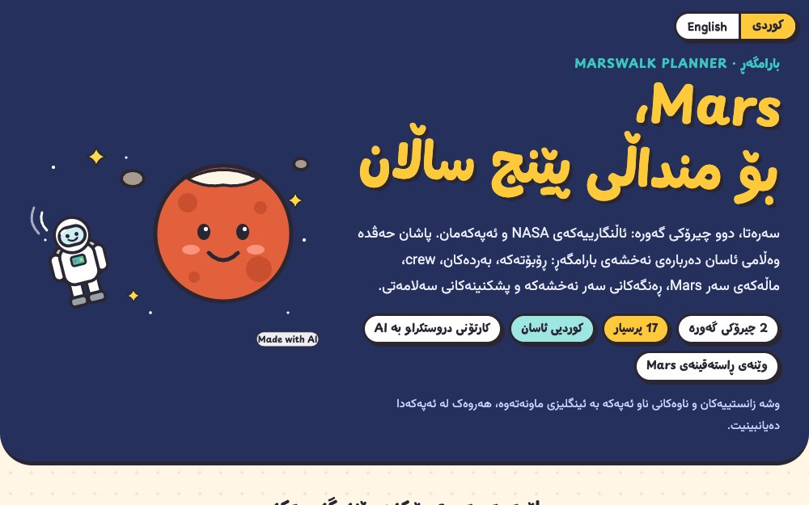

# Baramger: a Marswalk planner for Jezero crater

**The name.** Baramger (Kurdish: بارامگەڕ) is a compound word: *Baram* (بارام), an old name for the planet Mars, and *-ger* (گەڕ), "one that browses and explores", as in وێبگەڕ or تۆڕگەڕ ("web browser"). So Baramger means "Mars browser": a place to browse and explore Mars.

Baramger helps two astronauts plan a walk on Mars, stay safe on the way, and do real science at each stop. It was built for the NASA challenge **"Interplanetary Survival Guide: Martian Map"** (full text in [`TheChallenge.txt`](TheChallenge.txt)).

It layers NASA data from several missions into one offline map of a small walk area in Jezero crater, the place where the Perseverance rover works. It covers the whole walk: planning it the evening before, guiding the crew outside, and looking back afterwards.

## Mars, like I'm five (English · کوردی)

Easy cartoon answers about the NASA challenge, our app and the map, in **English** and **Central Kurdish (Sorani)**. Click a picture to read that language.

<p align="center">
<a href="docs/like-im-five/README.md"></a>
<a href="docs/like-im-five/README.ckb.md"></a>
</p>

- **Read it here on GitHub:** [English](docs/like-im-five/README.md) · [کوردی](docs/like-im-five/README.ckb.md)
- **The full cartoon page**, with its English | کوردی button: [`docs/Baramger-Like-Im-Five.html`](docs/Baramger-Like-Im-Five.html). GitHub cannot show it as a page, so download it and open it in a web browser.

## What it does

| Step | Screen | What the crew gets |
|---|---|---|
| **Start** | Habitat wall screen | A short launch animation: a telescope on Earth finds Mars, then the view flies to the planet. It ends on the whole of Mars, which can be turned and zoomed freely, in height colours or in natural colour, with arrows on its spin axis for the north and south poles. The walk zones are marked; click one to fly in. "Fly to Jezero crater" shows the whole crater as a sharp photo map with its official place names. |
| **Plan** | Habitat wall screen | A 3D map with layers (photo map, steep ground, rock types, rocky or dusty ground, the rover's path). Stops with real rover photos of each spot; the crew can add their own stops and name them. Known places keep their name on the map, also when they are not stops. The safest route between stops. A crew size and the load each astronaut carries. A safety check (time and reserve, slope, radio contact, daylight, sun activity, carried load, buddy rule, turn-back times). Walk conditions measured by Perseverance. A walk-through preview. An **Ask** tab: an AI assistant that explains the plan and the zone's data (needs internet; see "Mission assistant"). |
| **Walk** | Tablet on the suit arm | The next stop with distance, time and direction. Warnings ahead (steep ground, sand ripples, rocky ground, radio loss, running late, sunset). Stop timer and task list; picking up a tube or a sample adds to the crew's load and to the walking time. Skip a stop or head home, and the route re-plans from where the crew stands. Field notes pinned to the map. |
| **Helmet** | Helmet display (HUD) | An eye-level view with only the essentials: next stop, time left, radio, and one warning at a time. |
| **After** | Habitat | A replay of the walk, "plan and reality" per stop, and a printable walk report. "Send to Earth" shows today's Earth–Mars signal delay (about 11 minutes on 14 Nov 2026). |

On the tablet and in the helmet, the walk runs as a **time-lapse demo** along the approved route. On Mars, the suits' navigation would give the real position.

**A sense of scale.** A small card in the top-right corner of the map shows a scale bar and a drawing at the same scale (on a narrow map it sits under the map title). It changes with the zoom: a person in a suit, the Perseverance rover, NASA's Mars Reconnaissance Orbiter, a Space Shuttle orbiter, the International Space Station. From far away it says how many space stations would fit in the bar.

**The crew, life-size.** In the walk, the walk-through and the replay, each astronaut (1 to 4, A1 in front) is a 3D figure in a NASA spacesuit (the Z2 suit, a NASA prototype for walking on planets), at real size: they walk in single file, 3 m apart, and stand around a stop facing it. Up close you see the suits; from far away the round crew marker shows where they are.

**Controls.** A "Controls" box on the map moves the view with buttons (forward, back, left, right, up, down, turn, tilt, zoom; hold a button to keep moving) and a middle button that goes back to following the crew. In the walk, the walk-through and the replay it also has Play/Pause, a time slider, the play speed, and which astronaut the camera follows (A1 to A4); in the helmet view you see through that astronaut's visor.

**Ask the habitat assistant.** The Plan screen's Ask tab answers questions such as "Where do we lose radio contact?", "Which stop is best for sampling, and why?" or "What's the temperature at 14:00?". It looks the answer up in the zone's mission package and in the crew's plan, and shows the data values and source IDs (R1, R2, S4…) it used. Every answer is marked **AI explanation** with the provider and model that wrote it. The assistant never decides what is safe (Baramger's safety checks do), says "I can't tell from the mission data" when the data has no answer, and declines questions that are not about the walk. It needs internet; everything else works offline.

**Nothing scrolls.** Every screen is one side panel with tabs; details open in pop-ups, and long lists have pages. On a short window the panel is scaled down to fit. While the walk plays, no button moves or blinks: the screen updates only the text that changed.

## Two walk zones

| | Zone Z2: Bright Angel | Zone Z1: Three Forks |
|---|---|---|
| Science goal | Study the spotted rocks at Cheyava Falls | Collect the ten sample tubes Perseverance left on the ground |
| Stops | 4 | 10 |
| Route | 3.20 km, 3 h 42 min with stops | 1.23 km, 2 h 10 min with stops |
| Reserve (rule: at least 30%) | 38% | 64% |
| Steepest ground | 21° | 6° |
| Radio contact | 2 short gaps, 4 min at most | The whole walk |
| Weather reference | Perseverance MEDA, sols 1210–1218 (Jul 2024) | Perseverance MEDA, sols 653–659 (Dec 2022) |

The app opens on the whole planet. Click a marked zone on the map or press **Open** in the zone list. Inside a zone, the menu at the top of the map switches zones and **Mars globe** goes back to the planet. `#z1` / `#z2` in the address bar opens that zone.

**About the Z1 tube positions:** NASA publishes the exact tube spots only as a picture ([PIA25682](https://www.jpl.nasa.gov/images/pia25682-perseverances-three-forks-sample-depot-map/)), not as data. Each depot stop is where Perseverance parked while it dropped a tube, so the tube should lie within a few metres. The app says this on screen (assumption A14, to verify).

## Run the app

You need **Node.js** (tested with version 24) and **npm**. The two mission packages are already in this repository, so nothing needs to be downloaded or built first.

```bash
cd app
npm ci
npm run dev
```

Then open http://localhost:5173. The app works without internet: map tiles, terrain, photos, weather and fonts are all in the app and the mission packages.

- The launch animation plays once per browser tab. Add `?nointro` to the address to skip it; it is also skipped when the system asks for reduced motion. "Play the launch animation again" is on the whole-planet screen.
- The app is made for a wide window (about 1100 px or more). In a narrow window the map gets a small strip beside the panel; the `›` button hides the panel, and the helmet view uses the whole window.

Other commands, from the `app` folder:

```bash
npm test          # unit tests (vitest; the screen tests use jsdom)
npm run build     # type check + production build into app/dist
```

### Mission assistant (Ask tab), locally

The assistant runs in a Cloudflare Worker (`app/worker/`), which keeps the AI keys. To try it locally:

1. Put the keys in `app/.dev.vars` (git-ignored), one per line; any of the five is enough:
   ```
   GEMINI_API_KEY=...
   GROQ_API_KEY=...
   OPENROUTER_API_KEY=...
   MISTRAL_API_KEY=...
   CEREBRAS_API_KEY=...
   ```
2. In one terminal: `cd app && npm run build && npx wrangler dev` (the built site and the Worker on http://localhost:8787).
3. Either open http://localhost:8787, or run `npm run dev` in a second terminal and open http://localhost:5173: the dev server passes `/api` to the Worker.

Without the Worker (plain `npm run dev`), the Ask tab says the assistant isn't available; everything else works. The tests never call a real provider.

`app/public/package` and `app/public/cesiumStatic` are symbolic links (to `data/package` and to the CesiumJS build in `node_modules`). On Windows, turn on symlink support in git before cloning.

## Deploy (Cloudflare)

The app is hosted on Cloudflare as static files (Workers static assets, config in `app/wrangler.jsonc`), together with a small Worker script (`app/worker/index.ts`) that answers `POST /api/chat`, the mission assistant. All other paths are static files, as before. The live site on Vercel calls this Worker for the Ask tab.

- **Automatic:** the GitHub Actions workflow `.github/workflows/ci-deploy.yml` runs the app and pipeline tests on every push and pull request. On a push to `main`, it deploys the app if the tests pass.
- **By hand:** from the `app` folder, run `npx wrangler login` once, then `npm run deploy` (builds, then uploads `app/dist`).

The workflow needs two repository secrets (GitHub > Settings > Secrets and variables > Actions):

- `CLOUDFLARE_API_TOKEN`: a Cloudflare API token made from the "Edit Cloudflare Workers" template
- `CLOUDFLARE_ACCOUNT_ID`: the Cloudflare account ID

**The assistant's keys** are Worker secrets, set once with wrangler (they are never in git or in the app's files):

```bash
cd app
npx wrangler secret put GEMINI_API_KEY
npx wrangler secret put GROQ_API_KEY
npx wrangler secret put OPENROUTER_API_KEY
npx wrangler secret put MISTRAL_API_KEY
npx wrangler secret put CEREBRAS_API_KEY
```

Any subset works: a provider without a key is skipped.

**Where it runs (deployed 2026-11-15):** the Worker is at `https://baramger.baramger-app.workers.dev` (a full copy of the site is there too). The live site on Vercel calls it at that address (`WORKER_URL` in `app/src/ask.ts`; the build setting `VITE_ASK_API` overrides it), and the Worker accepts calls from `https://baramger.vercel.app` (`ALLOWED_ORIGINS` in `app/wrangler.jsonc`). Vercel preview addresses are not on that list, so the Ask tab there says the assistant isn't available. The GitHub workflow deploys the Worker only when the two Cloudflare secrets are set; until then, run `npm run deploy` from `app/` after changing the Worker.

## Rebuild a mission package (optional)

The data pipeline is in Python. You need **[uv](https://docs.astral.sh/uv/)**; it brings Python 3.12 and the GIS libraries itself.

```bash
cd pipeline
uv run baramger-build --zone z2      # or --zone z1
```

- Building both zones downloaded about 0.5 GB of raw data into `data/raw/` (not in git). This includes the walk-area window of the HiRISE 1 m terrain model, read with HTTP range requests from the USGS copy.
- Add `--skip-tiles --skip-photos` to reuse tiles and photos that were already downloaded.
- The build ends with "all checks passed" or a list of what failed, and it updates `data/package/index.json` (the app's zone list).
- NASA DONKI space-weather events are asked for at every build with NASA's shared demo key, which often has no calls left. Set `NASA_API_KEY` (a free key from api.nasa.gov) for steady access. NOAA SWPC sun data is always used.

Pipeline tests:

```bash
cd pipeline
uv run --group dev pytest -q
```

## Data sources and credits

The challenge lists five resources. Baramger uses all five; the mission package schema refuses a package that does not list them.

| ID | Source | Used for | Credit |
|---|---|---|---|
| R1 | [JPL Mars Trek](https://trek.nasa.gov/mars/) | HiRISE and CTX photo maps, HiRISE 1 m and CTX terrain, THEMIS night heat, the two whole-planet maps (MOLA height colours, Viking colour mosaic) | NASA/JPL-Caltech Mars Trek; instrument teams per layer |
| R2 | [USGS–NASA Planetary Geologic Mapping](https://planetarymapping.wr.usgs.gov/) | Rock types at each stop and along the route; the ten official place names on the crater map | Sun, V.Z., and Stack, K.M., 2020, [USGS SIM 3464](https://doi.org/10.3133/sim3464) |
| R3 | [Curiosity's Proposed Path up Mount Sharp (PIA23179)](https://www.jpl.nasa.gov/images/pia23179-curiositys-proposed-path-up-mount-sharp/) | Design reference for the annotated route (not map data) | NASA/JPL-Caltech/ESA/Univ. of Arizona/JHUAPL/MSSS/USGS |
| R4 | [NASA Worldview](https://worldview.earthdata.nasa.gov/) | Design reference for the layer list and compare view (Earth only, not Mars data) | NASA Worldview / EOSDIS |
| R5 | [Mars Perseverance Raw Images](https://mars.nasa.gov/mars2020/multimedia/raw-images/) | "What you will see" photos at each stop | Per image, e.g. NASA/JPL-Caltech/LANL/CNES/IRAP |

Extra sources are used **next to** the five resources, never instead of them. Each must pass five checks: no link to China, permission to use, verified from the official producer, a documented product, and real measured data.

| ID | Source | Used for | Credit |
|---|---|---|---|
| S1 | [Perseverance rover waypoints](https://mars.nasa.gov/mars2020/mission/where-is-the-rover/) | Placing rover photos on the map; the Z1 depot stops | NASA/JPL-Caltech |
| S4 | [Perseverance MEDA weather, NASA PDS](https://atmos.nmsu.edu/PDS/data/PDS4/Mars2020/mars2020_meda/) | Air and ground temperature, air pressure | NASA/JPL-Caltech/CAB (MEDA), NASA PDS |
| S7 | [NOAA Space Weather Prediction Center](https://www.swpc.noaa.gov/) | Solar flares and particle levels (measured near Earth) | NOAA SWPC |
| S3 | [NASA DONKI](https://kauai.ccmc.gsfc.nasa.gov/DONKI/) | The number of solar particle events in the 30 days before the build: one sentence under "Checks and limits", when the service answers at build time. The sun values on screen are NOAA's | NASA CCMC DONKI |
| S9 | [NASA 3D Resources: Z2 Spacesuit](https://science.nasa.gov/3d-resources/z2-spacesuit/) | The 3D crew figures (the app ships a cleaned, lighter copy: see Limits) | NASA/LaRC/Advanced Concepts Lab, via NASA 3D Resources |
| S8 | NASA fact pages ([Perseverance](https://science.nasa.gov/mission/mars-2020-perseverance/rover-components/), [MRO press kit](https://www.jpl.nasa.gov/news/press_kits/mro-launch.pdf), [Space Shuttle](https://www.nasa.gov/reference/the-space-shuttle/), [space station](https://www.nasa.gov/international-space-station/space-station-facts-and-figures/)) | Real sizes of the drawings in the scale card | NASA; NASA/JPL-Caltech (Perseverance, MRO) |

The full source ledger, with what was checked and when, is in [`data/sources.registry.json`](data/sources.registry.json). Every photo in the app carries its own credit line.

NASA does not endorse this project.

### Software, fonts, pictures and methods

Everything else the project uses, with its license. Open-source code is used as published, through npm and PyPI.

| Kind | What | License / credit |
|---|---|---|
| Map engine | [CesiumJS](https://cesium.com/platform/cesiumjs/) 1.146 | Apache-2.0, Cesium GS, Inc. |
| App tools | [Vite](https://vite.dev/) 8, [TypeScript](https://www.typescriptlang.org/) 6, [Vitest](https://vitest.dev/) 5, [jsdom](https://github.com/jsdom/jsdom) 29 | MIT; TypeScript Apache-2.0 |
| Optional deploy tool | [Wrangler](https://developers.cloudflare.com/workers/wrangler/) 4 (Cloudflare) | MIT or Apache-2.0 |
| Data pipeline (Python 3.12) | [NumPy](https://numpy.org/), [SciPy](https://scipy.org/), [rasterio](https://rasterio.readthedocs.io/) with [GDAL](https://gdal.org/), [pyogrio](https://pyogrio.readthedocs.io/), [Shapely](https://shapely.readthedocs.io/) with GEOS, [pyproj](https://pyproj4.github.io/pyproj/) with PROJ, [Pillow](https://python-pillow.org/), [jsonschema](https://python-jsonschema.readthedocs.io/), [pytest](https://pytest.org/), [hatchling](https://hatch.pypa.io/), [uv](https://docs.astral.sh/uv/) | BSD-3-Clause, MIT, Apache-2.0, LGPL (GEOS) and HPND (Pillow), as each project publishes |
| App fonts | Inter (Rasmus Andersson), Barlow Semi Condensed (Jeremy Tribby), IBM Plex Mono (IBM), through [Fontsource](https://fontsource.org/) | SIL Open Font License 1.1 |
| Fonts of the "like I'm five" page | [Playpen Sans Arabic](https://github.com/TypeTogether/Playpen-Sans) (The Playpen Sans Project Authors) and [Vazirmatn](https://github.com/rastikerdar/vazirmatn) (Saber Rastikerdar), embedded as subsets | SIL Open Font License 1.1 |
| Fonts of the other HTML pages | Inter, Barlow Semi Condensed, IBM Plex Mono, IBM Plex Sans, loaded from [Google Fonts](https://fonts.google.com/) | SIL Open Font License 1.1 |
| Photos in the "like I'm five" page | Perseverance raw images (sols 653, 670, 1159, 1210) and [PIA26368](https://science.nasa.gov/resource/perseverance-finds-a-rock-with-leopard-spots/) ("leopard spots"); a HiRISE view via Mars Trek | NASA/JPL-Caltech; NASA/JPL-Caltech/ASU (Mastcam-Z); NASA/JPL-Caltech/University of Arizona (HiRISE) |
| The leopard photo in that page | ["Leopard (Panthera pardus pardus) Kruger 2"](https://commons.wikimedia.org/wiki/File:Leopard_(Panthera_pardus_pardus)_Kruger_2.jpg), cropped twice (whole animal, fur close-up) | Charles J. Sharp, Sharp Photography, [CC BY-SA 4.0](https://creativecommons.org/licenses/by-sa/4.0/), via Wikimedia Commons. Only an illustration, not map data |
| Sunrise, sunset, Mars time | Mars24 Sunclock equations (Allison & McEwen 2000) | NASA Goddard Institute for Space Studies |
| Earth–Mars signal delay | "Approximate Positions of the Major Planets" (E. M. Standish) | NASA/JPL Solar System Dynamics |
| Walking speed on slopes | Tobler's hiking function (Tobler 1993), scaled to a suited astronaut's speed on flat ground (A3) | Published method |
| Suit and body mass for the carried load | NASA JSC, "Mars Spacesuit Mass Requirements", ICES-2026-127 (NTRS 20260005410) | NASA planning values (A15–A21) |
| Route search | A* search on the 2 m grid (Hart, Nilsson and Raphael 1968) | Published method |
| Hosting and checks | [Vercel](https://vercel.com/) (the live site), [Cloudflare Workers](https://workers.cloudflare.com/) (the mission assistant's API and a second copy of the site), [GitHub](https://github.com/) and GitHub Actions (tests on every push) | Services |
| Mission assistant (Ask tab) | AI models called by our Worker, in this order: [Gemini](https://ai.google.dev/) `gemini-3.5-flash-lite` (Google), [Groq](https://groq.com/) `openai/gpt-oss-120b`, [OpenRouter](https://openrouter.ai/) `openai/gpt-oss-120b` (hosts DeepInfra, CoreWeave or Together), [Mistral AI](https://mistral.ai/) `ministral-14b-2512`, [Cerebras](https://www.cerebras.ai/) `gpt-oss-120b`. gpt-oss is by OpenAI (Apache 2.0) | Services, each under its own terms. Answers are labelled AI and never stored |
| Tools used while building | [Claude Code](https://claude.com/claude-code) (Anthropic), see "Use of AI" below; MCP servers [`nasa`](https://www.npmjs.com/package/@programcomputer/nasa-mcp-server), `pds` (NASA PDS Registry API) and [`gdal-mcp`](https://pypi.org/project/gdal-mcp/) 1.1.3, used to look up and check data. Their answers were checked against the official sources | Tools, not shipped with the app |

## Use of AI

The NASA Space Apps rules ask every team to say where and how AI tools ("Super Intelligence", SI) were used. This is our answer.

- **The tool.** We built Baramger with [Claude Code](https://claude.com/claude-code), an AI coding assistant made by Anthropic. No AI image or video generator was used.
- **What the AI did.** It wrote most of the code (the web app, the Python data pipeline and their tests) and the project documents, following our requests, and it checked data sources against the project's rules. It also wrote the "like I'm five" page and its Kurdish (Sorani) translation, and drew every cartoon and diagram in this repository as SVG code. It cropped and resized the photos we chose.
- **What the team did.** The team chose the challenge and made the project's decisions: the place (Jezero crater), the two walk zones, what to build and in which order, which extra data sources to allow, and the rules for that data. These decisions are recorded in [`docs/PLAN.md`](docs/PLAN.md) and [`CLAUDE.md`](CLAUDE.md). The team tested the app and asked for changes.
- **No AI-made data.** Every map, measurement, rover position and photo comes from NASA, USGS or NOAA (sources above). The AI did not make up any data: values that are not measured are called starting values (A1–A22) and are listed on screen.
- **The mission assistant in the app (Ask tab).** The app itself uses AI in one place: the Ask tab on the Plan screen. A question goes to our Cloudflare Worker, which asks one of five AI providers in a fixed order (Gemini, Groq, OpenRouter, Mistral, Cerebras; the next one answers when one is busy or fails). The model may only answer from tools that read the zone's mission package and the crew's plan; it never decides what is safe (Baramger's own checks do) and says "I can't tell from the mission data" when the data has no answer. **Every answer is labelled "AI explanation"** and names the provider and model that wrote it, and it lists the source IDs and data values it used. Those values come straight from the package, not from the model. AI answers are never saved into a mission package or shown as measurements. The team chose the providers, the order, the rules and the limits; the AI coding assistant wrote the code and the tests, and checked each provider's docs and terms (results in [`docs/PLAN.md`](docs/PLAN.md), "AI mission assistant").
- **How AI-made work is marked.** The pictures drawn with AI carry a visible **"Made with AI"** mark: the cartoons and diagrams in `docs/`, and the night sky at the start of the app. The app's small interface drawings (the outlines in the scale card, map markers and icons) were also drawn as code with AI; they are named here instead of each carrying a mark. Code and text written with AI are marked in their metadata: each commit made with the assistant names it in a `Co-Authored-By` line, and the HTML pages carry an `ai-assistance` meta tag.

## How it works

1. **Pipeline** (`pipeline/`) builds one offline **mission package** per zone in `data/package/`: terrain grids, a 2 m routing grid with slope and roughness, no-go areas (steeper than 25°), rock types, map tiles, rover photos and positions, weather, daylight and sun activity. Every download is recorded with its URL and time, and with a sha256 where the file is kept (map tiles are listed per layer). The package is checked against [`schema/marswalk.schema.json`](schema/marswalk.schema.json).
2. **App** (`app/`, Vite + TypeScript + CesiumJS 1.146) loads the package and does the rest in the browser: route finding (A* with walking speed by slope), radio line of sight from the habitat antenna, safety checks, the walk demo, the replay and the report. CesiumJS is the only map engine: the Mars in the launch animation is the same globe the crew then plans on (the night sky before it is a drawing, and the screen says so).

Some facts we checked along the way:

- Mars is drawn on the **Mars 2000 sphere** (radius 3,396,190 m). CesiumJS's built-in `Ellipsoid.MARS` is flattened and would shift latitudes by about 12 km at Jezero.
- The slope map agrees with the rover's own tilt sensor: **1.9° mean error** at 79 rover positions (Z2) and **1.3°** at 124 (Z1).
- Sunrise and sunset use the NASA GISS Mars24 equations, within 0.6 minutes of the rover's own times.
- Earth–Mars signal delay uses JPL's approximate planet elements, checked against astropy to 0.0001 AU.

## Limits and open assumptions

- **Starting values to confirm (A1–A22).** For example: 15° comfortable slope, 25° maximum slope, 2.5 km/h walking speed on flat ground, a 6-hour walk, and 30% time kept in reserve. The app lists them on screen.
- **Carried load is a model, not a measurement.** Walking time grows with the mass each astronaut moves (body + suit + load, about +0.5% per extra kg), using NASA planning values for body and suit mass (A15–A21). NASA has no published test of suited walking speed versus load at Mars gravity yet.
- **Small rocks.** The terrain model has 1 m detail and routing uses 2 m cells. Rocks smaller than that do not show up as obstacles; the crew sees them on the 25 cm photo map and in the rover photos.
- **Rock borders.** The USGS rock map's unit borders can be 100–200 m off (USGS readme), and the app says so. Unit names are shown exactly as USGS publishes them, including its typo "Crater riim unit".
- **Weather and sun activity** are real measurements from a reference period, not a forecast for the day of the walk. Sun activity is measured near Earth.
- **Demo mode.** The walk runs as a time-lapse on one screen, and "Send to Earth" saves the report files instead of sending them.
- **The planet's colours are approximate.** The whole-planet map has two looks from Mars Trek. "Height colours" is the MOLA height map (blue is low ground, not water). "Natural colour" is the Viking orbiter mosaic, which its producer (USGS) calls a colourised mosaic. Mars Trek has no true-colour map of the planet, and its photo maps of Jezero (CTX, HiRISE) are grey.
- **The wide photo map of the crater is for context only.** Mars Trek calls that CTX mosaic preliminary: it lies about 80 m off the controlled mosaic and shows seams. Routes, slopes and stops use only the controlled HiRISE and CTX data of each walk zone. The whole-crater view stays inside this photo map when the window's shape allows it; on a very wide or a tall, narrow window the coarser planet map shows at its edges. The mosaic also has one small gap (about 3 km²) south-west of the rim.
- **Place names** are the ten official names printed on the USGS map (Jezero, Belva, Neretva Vallis and others). Each stands where the map prints it: good from far away, not exact. Bright Angel, Cheyava Falls and Three Forks are the Perseverance team's own informal names.
- **The crew figures** are NASA's Z2 Spacesuit model, drawn at its own size (about 1.93 m). The app's copy leaves out NASA's duplicate JPEG pictures and an unused bump picture, and takes off the grime painted on the suit's white fabric (seams, stripes, flag and patches kept). The model has no moving legs, so the figures glide along the route. From the tablet's top view they are only a few pixels tall; the round crew marker shows them there.
- **The walk's time slider only goes forward.** A walk is played as it happens; going back in time is what the replay after the walk is for.
- **The scale card** measures the map's scale at the middle of the view; a tilted view has no single scale. Its drawings are simple silhouettes with real overall sizes (NASA); the person (1.8 m, starting value A22) is a round value.

## Repository layout

```
app/         CesiumJS web app (launch animation, Mars globe, Plan, Walk, helmet display, replay, report)
app/worker/  Cloudflare Worker: POST /api/chat, the mission assistant (data tools, five AI providers, fallback chain)
app/public/models/  the crew figure (cleaned copy of NASA's Z2 Spacesuit model; made by pipeline/baramger_pipeline/suit_model.py)
pipeline/    Python pipeline that builds and checks the mission packages
data/        mission packages (data/package/) and the source ledger
schema/      JSON Schema for mission packages and the source ledger
docs/        plan, report, short summary, user scenario, MCP guide, "like I'm five" page, assistant demo script
docs/like-im-five/  GitHub copy of the "like I'm five" page (English + Sorani Markdown, drawings)
CLAUDE.md    project brief for Claude Code
```

More detail: [`docs/PLAN.md`](docs/PLAN.md) (analysis, decisions, findings), [`docs/Baramger-Report.html`](docs/Baramger-Report.html) (full report), [`docs/Baramger-Summary.html`](docs/Baramger-Summary.html) (short summary for everyone), and [`docs/Baramger-User-Scenario.html`](docs/Baramger-User-Scenario.html) (the story of two walks, told from the user's side). These three pages were written on 14 November 2026, before the later rounds of work, so some screens and details in them are older than the app. The live app and this README show the current version.

## License

No license has been chosen yet. NASA, USGS and NOAA data keep their own terms and credits, listed above.
