

<a href="README.md">English</a> · <b>کوردی</b>

# <bdi>Mars</bdi>، بۆ منداڵی پێنج ساڵان

بارامگەڕ · <bdi>Marswalk planner</bdi>

سەرەتا، دوو چیرۆکی گەورە: ئاڵنگارییەکەی <bdi>NASA</bdi> و ئەپەکەمان. پاشان حەڤدە وەڵامی ئاسان دەربارەی نەخشەی بارامگەڕ: ڕۆبۆتەکە، بەردەکان، <bdi>crew</bdi>، ماڵەکەی سەر <bdi>Mars</bdi>، ڕەنگەکانی سەر نەخشەکە و پشکنینەکانی سەلامەتی.

<b>2 چیرۆکی گەورە</b> · <b>17 پرسیار</b> · <b>کوردیی ئاسان</b> · <b>کارتۆنی دروستکراو بە AI</b> · <b>وێنەی ڕاستەقینەی <bdi>Mars</bdi></b>

وشە زانستییەکان و ناوەکانی ناو ئەپەکە بە ئینگلیزی ماونەتەوە، هەروەک لە ئەپەکەدا دەیانبینیت.

> 🖍️ <b>ئەمە وەشانی <bdi>GitHub</bdi>ـە.</b> <bdi>GitHub</bdi> ناتوانێت پەڕە کارتۆنییەکە خۆی پیشان بدات. بۆ دیزاینی تەواو و دوگمەی <b><bdi>English | کوردی</bdi></b>، فایلی [<bdi>Baramger-Like-Im-Five.html</bdi>](../Baramger-Like-Im-Five.html) دابەزێنە و لە وێبگەڕێکدا بیکەرەوە.

## لێرەوە دەست پێبکە: وێنە گەورەکە

- <b>A</b> · [ئاڵنگارییەکەی <bdi>NASA</bdi> چییە؟](#ku-challenge)
- <b>B</b> · [ئەپەکەمان (بارامگەڕ) چییە؟](#ku-app)

## پرسیارێک هەڵبژێرە

- <b>1</b> · [هێڵە سپییە پچڕپچڕەکان](#ku-lines)
- <b>2</b> · [<bdi>Perseverance</bdi> چییە؟](#ku-perseverance)
- <b>3</b> · [بۆچی ئەم ئاڵنگارییە پێویستە؟](#ku-why)
- <b>4</b> · [<bdi>crew</bdi> کێن؟](#ku-crew)
- <b>5</b> · [<bdi>Cheyava Falls</bdi>](#ku-cheyava)
- <b>6</b> · [لوولە بچکۆلە بەردییەکان](#ku-tubes)
- <b>7</b> · [<bdi>Three Forks</bdi>](#ku-threeforks)
- <b>8</b> · [<bdi>Bright Angel</bdi>](#ku-brightangel)
- <b>9</b> · [<bdi>Jezero crater</bdi>](#ku-jezero)
- <b>10</b> · [<bdi>sol</bdi> چییە؟](#ku-sol)
- <b>11</b> · [<bdi>Habitat</bdi>](#ku-habitat)
- <b>12</b> · [ناوچە سوور و زەردەکان](#ku-colours)
- <b>13</b> · [«<bdi>Suggest order</bdi>»](#ku-order)
- <b>14</b> · [کات و یەدەگ](#ku-reserve)
- <b>15</b> · [پەیوەندیی ڕادیۆیی](#ku-radio)
- <b>16</b> · [چالاکیی خۆر](#ku-sun)
- <b>17</b> · [جۆرەکانی بەرد، بە وێنەی ڕاستەقینە](#ku-rocks)

---

## A. ئاڵنگارییەکەی <bdi>NASA</bdi> چییە؟

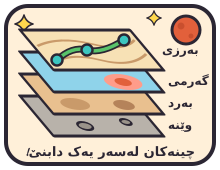

ڕۆژێک خەڵک لەسەر <bdi>Mars</bdi> پیاسە دەکەن. <bdi>NASA</bdi> دەپرسێت: <b>«دەتوانن ئەو نەخشەیە دروست بکەن کە پێویستیانە؟»</b>

کاتێک دەچیتە شوێنێکی نوێ، پێویستت بە نەخشەیەکی باشە. <bdi>Mars</bdi> زۆر دوورە و مەترسیدارە: هەوای هەناسەدانی تێدا نییە، زۆر ساردە، و هەموو شوێنێکی پڕە لە بەرد و تۆز. بۆیە <bdi>astronaut</bdi>ەکان پێویستیان بە <b>نەخشەیەکی زۆر زۆر باش</b> هەیە.

### ئەو نەخشانەی ئێستا هەمانن چ کێشەیەکیان هەیە؟

<bdi>NASA</bdi> چەندین ساڵە ڕۆبۆت دەنێرێت بۆ <bdi>Mars</bdi>. ئەو ڕۆبۆتانە <b>وێنەیەکی زۆریان</b> گرتووە و <b>پێوانەیەکی زۆریان</b> کردووە.

بەڵام هەموو ئەم زانیارییانە لە زۆر شوێنی جیاوازدان، وەک ئەو یارییانەی بە هەموو ژوورێکی گەورەدا بڵاو بوونەتەوە. ئەو نەخشانەی ئێستا هەمانن <b>هەموو هەسارەکە</b> یان <b>ناوچەی گەورە</b> پیشان دەدەن. <bdi>astronaut</bdi>ێک لە کاتی پیاسەدا پێویستی بە نەخشەی <b>یەک شوێنی بچووک</b> هەیە: «ئەمڕۆ بە کوێدا بڕۆم؟»

### <bdi>NASA</bdi> دەیەوێت چی دروست بکەین؟

نەخشەیەک یان ئامرازێک کە یارمەتی <bdi>astronaut</bdi>ێک بدات <b><bdi>Marswalk</bdi></b>ێک بکات (پیاسەیەک لەسەر <bdi>Mars</bdi>، بە <bdi>spacesuit</bdi>ەوە). دەبێت:

1. <b>شوێنێک هەڵبژێرێت</b> لەسەر <bdi>Mars</bdi>. شوێنێک کە ڕۆبۆتەکان پێشتر سەیریان کردبێت ئاسانترە، چونکە وێنەی زۆری هەیە.
2. <b>ئەرکێکی زانستی هەڵبژێرێت</b>، بۆ نموونە «بڕۆ سەیری ئەم بەردە تایبەتانە بکە.»
3. <b><bdi>layer</bdi>ەکان لەسەر یەک دابنێت</b>، وەک ستیکەری ڕوون لەسەر یەک وێنە: وێنە لە بۆشایی ئاسمانەوە، زەوی چەند بەرز یان نزمە، چەند گەرم یان ساردە، چ جۆرە بەردێکی لێیە، و کەشوهەوای بۆشایی ئاسمان (<bdi>space weather</bdi>)، چونکە خۆر دەتوانێت تیشکی مەترسیدار بنێرێت. <bdi>NASA</bdi> پێشنیار دەکات <b>لانیکەم سێ جۆر</b> بێت.
4. <b>ڕێگایەکی سەلامەت پیشان بدات</b>: بە دەوری بەردە گەورەکاندا، نەک بەسەر گردی زۆر لێژدا. لە بیرت بێت کە <bdi>spacesuit</bdi>ەکە قورسە و <bdi>astronaut</bdi>ەکە ئامرازیش هەڵدەگرێت.
5. <b>پیشان بدات شوێنەکە چۆن دەردەکەوێت.</b> وێنەکانی ڕۆبۆتەکە لەسەر زەوی بەکار بهێنێت، تا <bdi>astronaut</bdi>ەکە بڵێت: «ئۆ، پێشتر ئەم شوێنەم بینیوە!»

> 💡 <b>یاسای یەکەمی <bdi>NASA</bdi></b>
>
> <b>سەلامەتی پێش هەموو شتێک.</b> نەخشەکە دەبێت یارمەتی <bdi>astronaut</bdi>ەکان بدات <b>بە سەلامەتی بگەڕێنەوە ماڵەوە</b>.

### نەخشەکە دەتوانێت لە کوێ بێت؟

ئێمە هەڵی دەبژێرین. <bdi>NASA</bdi> هەندێک بیرۆکە دەدات:

- <b>شاشەیەکی گەورە لەناو ماڵەکەیان</b> (<bdi>Habitat</bdi>، [پرسیاری 11](#ku-habitat))، بۆ پلاندانانی پیاسەکە
- <b>تابلێتێک</b> کە <bdi>astronaut</bdi>ەکە لەگەڵ خۆی دەیبات
- شاشەیەکی بچووک <b>لەسەر شووشەی کڵاوەکە</b> (<bdi>helmet</bdi>)

### ئەو پێنج یاریدەدەرەی <bdi>NASA</bdi> پێمانی دەدات

<bdi>NASA</bdi> هەروەها پێنج «یاریدەدەر»مان دەداتێ: شوێنی پڕ لە زانیاری.

- <b>R1</b> · <b><bdi>Mars Trek</bdi></b> (<bdi>JPL</bdi>): کتێبێکی وێنەی گەورەی <bdi>Mars</bdi>، کە لە بۆشایی ئاسمانەوە بینراوە.
- <b>R2</b> · <b><bdi>Geologic maps</bdi></b> (<bdi>USGS</bdi> و <bdi>NASA</bdi>): نەخشەیەکی ڕەنگکراو کە جۆرەکانی بەرد پیشان دەدات.
- <b>R3</b> · <b>نەخشەی ڕێگای <bdi>Curiosity</bdi></b>: ڕێگایەک کە بۆ ڕۆبۆتێکی تر کێشراوە، لە بەشێکی تری <bdi>Mars</bdi>. بۆ بیرۆکە باشە، بەڵام داتای نەخشە نییە.
- <b>R4</b> · <b><bdi>NASA Worldview</bdi></b>: نەخشەی زەوی. تەنها بۆ بیرۆکە باشە. <b><bdi>Mars</bdi> نییە!</b>
- <b>R5</b> · <b><bdi>Perseverance raw images</bdi></b>: زیاتر لە ملیۆنێک وێنە کە ڕۆبۆتەکە لەسەر زەوی گرتوونی.

> 📱 <b>بە یەک ڕستە</b>
>
> وێنە و پێوانە زۆرەکانی <bdi>NASA</bdi> دەربارەی <bdi>Mars</bdi> وەربگرە، بیانخە سەر یەک و بیانکە بە <b>یەک نەخشەی زیرەک بۆ یەک شوێنی بچووک</b>، و یارمەتی <bdi>astronaut</bdi>ێک بدە پلانی <b>پیاسەیەکی سەلامەت</b> دابنێت و تەواوی بکات بۆ ئەوەی کاری زانستی بکات.

[پرسیاری 3](#ku-why) دەڵێت بۆچی پێویستمان بە مرۆڤە، نەک تەنها ڕۆبۆت. [چیرۆکی B](#ku-app) پیشان دەدات چیمان دروست کردووە.

[↑ گەڕانەوە بۆ لیستەکە](#ku-start)

---

## B. ئەپەکەمان (بارامگەڕ) چییە؟

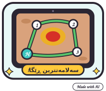

<b>بارامگەڕ ئەپێکی یاریدەدەرە بۆ <bdi>astronaut</bdi>ەکان لەسەر <bdi>Mars</bdi>.</b>

دوو <bdi>astronaut</bdi> دەیانەوێت بۆ کاری زانستی پیاسەیەک لەسەر <bdi>Mars</bdi> بکەن. بارامگەڕ یارمەتییان دەدات پلانی پیاسەکە <b>دابنێن</b>، بە سەلامەتی <b>بیکەن</b>، و دواتر <b>لە بیریان بمێنێت</b>.

> 💡 <b>بۆچی «بارامگەڕ»؟</b>
>
> وشەیەکی لێکدراوی کوردییە و لە دوو بەش پێکهاتووە: <b>بارام</b>، کە ناوێکی کۆنی هەسارەی <bdi>Mars</bdi>ە، و <b>گەڕ</b>، واتە ئەو کەس یان شتەی دەگەڕێت و دەدۆزێتەوە، وەک «وێبگەڕ» و «تۆڕگەڕ» (<bdi>web browser</bdi>). کەواتە <b>بارامگەڕ</b> واتە «گەڕۆکی <bdi>Mars</bdi>»: شوێنێک بۆ گەڕان و دۆزینەوەی <bdi>Mars</bdi>.

### پیاسەکە لە کوێیە؟

لە <b><bdi>Jezero crater</bdi></b> ([پرسیاری 9](#ku-jezero))، چاڵێکی گەورەی خڕ لەسەر <bdi>Mars</bdi> کە زۆر زۆر لەمەوبەر دەریاچە بوو. ڕۆبۆتی <bdi>Perseverance</bdi> ([پرسیاری 2](#ku-perseverance)) ئێستا لەوێ دەڕوات، بۆیە وێنەی زۆرمان لەم شوێنە هەیە.

دەتوانیت یەکێک لە <b>دوو پیاسە</b> هەڵبژێریت:

> #### پیاسەی <bdi>Z2</bdi>: <bdi>Bright Angel</bdi>
>
> <b>ئەرکەکە:</b> سەیرکردنی ئەو بەردەی پەڵەی پڵنگئاسای پێوەیە ([<bdi>Cheyava Falls</bdi>](#ku-cheyava)).
>
> <b>چەند درێژە:</b> نزیکەی 3 کیلۆمەتر، نزیکەی 4 کاتژمێر لەگەڵ وەستانەکان.
>
> <b>چەند قورسە:</b> هەندێک گردی لێژی تێدایە.

> #### پیاسەی <bdi>Z1</bdi>: <bdi>Three Forks</bdi>
>
> <b>ئەرکەکە:</b> هەڵگرتنەوەی ئەو [10 لوولە بەردییەی](#ku-tubes) ڕۆبۆتەکە لەسەر زەوی جێی هێشتوون.
>
> <b>چەند درێژە:</b> نزیکەی 1 کیلۆمەتر، کەمێک زیاتر لە 2 کاتژمێر لەگەڵ وەستانەکان.
>
> <b>چەند قورسە:</b> زۆربەی تەخت و ئاسانە.

### ئەپەکە، هەنگاو بە هەنگاو

1. <b>سڵاو، <bdi>Mars</bdi>!</b> ئەپەکە بە نمایشێکی بچووک دەست پێدەکات: تەلیسکۆپێک لەسەر زەوی <bdi>Mars</bdi> دەدۆزێتەوە، و تۆ بەرەو ئەوێ دەفڕیت. هەموو هەسارەکە دەبینیت و دەتوانیت بیسوڕێنیت. شوێنەکانی پیاسە نیشانە کراون: کرتە لە یەکێکیان بکە، و دەفڕیت بۆ ئەوێ.
2. <b>پلانی پیاسەکە دابنێ</b>، لەناو <bdi>Habitat</bdi>، ئێوارەی پێشتر. <b>نەخشەیەکی گەورەی <bdi>3D</bdi></b> چەند <bdi>layer</bdi>ێکی هەیە، وەک چینەکانی کێک: وێنە لە بۆشایی ئاسمانەوە، زەویی لێژ ([پرسیاری 12](#ku-colours))، جۆرەکانی بەرد، و ڕێگای ڕۆبۆتەکە ([پرسیاری 1](#ku-lines)). هەر وێستگەیەک <b>وێنەی ڕاستەقینەی ڕۆبۆتەکەی</b> هەیە، بۆ ئەوەی <bdi>astronaut</bdi>ەکان بزانن چی دەبینن. پاشان ئەپەکە <b>سەلامەتترین ڕێگا</b> دەدۆزێتەوە، وەک ئەپی نەخشەی ناو ئۆتۆمبێل کە بە دەوری چاڵ و گردی لێژدا دەسوڕێتەوە.
3. <b>پشکنینی سەلامەتی.</b> پێش ئەوەی بڕۆن، ئەپەکە زۆر پرسیار دەکات، وەک دایک و باوکێکی بە ئاگا (لیستەکەی خوارەوە ببینە).
4. <b>سەرەتا ڕاهێنان بکە.</b> <bdi>astronaut</bdi>ەکان دەتوانن پێش پیاسە ڕاستەقینەکە، سەیری پیاسەیەکی خەیاڵی لەسەر نەخشەکە بکەن.
5. <b>پیاسەکە، بە تابلێتێک لەسەر قۆڵ.</b> دەڵێت وێستگەی داهاتوو بە کام لادایە و چەند دوورە. ئاگاداریان دەکاتەوە: «ئاگادار بە! زەویی لێژ لە پێشەوەیە.» «خۆرئاوا نزیکە.» «لێرە ڕادیۆ نییە.» ئەگەر شتێک بە هەڵەدا چوو، کرتە لە <b><bdi>Head home</bdi></b> دەکەن، و ئەپەکە ڕێگایەکی نوێ بۆ ماڵەوە دەدۆزێتەوە.
6. <b>پیاسەکە، لەناو کڵاوەکەدا.</b> شاشەیەکی بچکۆلە لەسەر شووشەی کڵاوەکە (<bdi>HUD</bdi>) تەنها گرنگترین شتەکان پیشان دەدات: وێستگەی داهاتوو، کاتی ماوە، ڕادیۆ، و هەر جارە یەک ئاگادارکردنەوە.
7. <b>دوای پیاسەکە.</b> لە ماڵەوە، ئەپەکە پیاسەکە وەک فیلمێک دووبارە پیشان دەداتەوە، «ئەوەی پلانمان بۆ دانابوو» لە تەنیشت «ئەوەی بە ڕاستی ڕوویدا» دادەنێت، و <b>ڕاپۆرتێک</b> دروست دەکات. پاشان <b><bdi>Send to Earth</bdi></b> پیشان دەدات نامەکە چەندی پێدەچێت تا دەگاتە زەوی: نزیکەی <b>11 خولەک</b> لە 14ی تشرینی دووەمی 2026. ئەمە هەموو ڕۆژێک دەگۆڕێت، لە نزیکەی 3 تا 22 خولەک، چونکە زەوی و <bdi>Mars</bdi> بە دەوری خۆردا دەسوڕێنەوە.

### پشکنینی سەلامەتی دەپرسێت…

- ئایا <b>کاتی پێویست</b> هەیە بۆ گەڕانەوە، لەگەڵ کاتێکی زیادە بۆ دڵنیایی؟
- ئایا هیچ گردێک <b>زۆر لێژە</b>؟
- ئایا <bdi>astronaut</bdi>ەکان هەمیشە دەتوانن <b>بە ڕادیۆ قسە</b> لەگەڵ <bdi>Habitat</bdi> بکەن؟
- ئایا <b>پێش تاریکبوون</b> دەگەڕێنەوە؟
- ئایا ئەمڕۆ <b>خۆر ئارامە</b>، یان تیشکی مەترسیدار دەنێرێت؟
- ئایا جانتاکانیان <b>زۆر قورسن</b>؟ جانتای قورس ڕۆیشتن هێواشتر دەکات.
- ئایا هەمیشە <b>پێکەوە</b> دەڕۆن؟ ئەمە پێی دەوترێت <bdi>buddy rule</bdi> ([پرسیاری 4](#ku-crew)).

### شتە خۆشە زیادەکان

- <b>کارتی قەبارە.</b> کارتێکی بچووک لەسەر نەخشەکە پیشان دەدات شتەکان چەند گەورەن: مرۆڤێک، ڕۆبۆتەکە، کەشتییەکی ئاسمانی، وێستگەیەکی ئاسمانی. کاتێک <bdi>zoom</bdi> دەکەیت، وێنەکە دەگۆڕێت.
- <b>دوو شێوەی هەسارە.</b> «<bdi>Height colours</bdi>» (شین واتە زەویی نزم، نەک ئاو!) یان «<bdi>Natural colour</bdi>» (نزیکە لە ڕەنگە ڕاستەقینەکانی <bdi>Mars</bdi>، بەڵام ڕێک وەک خۆی نییە).
- <b>ناوی ڕاستەقینەی شوێنەکان.</b> دە ناوی فەرمی لە نەخشەی بەردی <bdi>USGS</bdi>، وەک <bdi>Jezero</bdi> و <bdi>Neretva Vallis</bdi>.
- <b>پێویستی بە ئینتەرنێت نییە.</b> هەموو شتێک لەناو ئەپەکەدایە. ئەمەش باشە، چونکە <bdi>Mars</bdi> <bdi>Wi-Fi</bdi>ی نییە!

### زانیارییەکان لە کوێوە دێن؟

لە <b>داتای ڕاستەقینەی <bdi>NASA</bdi></b>، زۆربەی لە پێنج یاریدەدەرەکەی [چیرۆکی A](#ku-challenge): وێنەی بۆشایی ئاسمان و نەخشەی بەرزی (<bdi>R1</bdi>)، نەخشەی بەرد و ناوی شوێنەکان (<bdi>R2</bdi>)، و وێنەکانی ڕۆبۆتەکە لەسەر زەوی (<bdi>R5</bdi>). هەندێک داتای ڕاستەقینەی زیادەش هەیە: ڕێگای ڕۆبۆتەکە (<bdi>S1</bdi>)، وێستگەی کەشوهەواکەی (<bdi>S4</bdi>)، و پێوانەکانی خۆر لە <bdi>NOAA</bdi>، کە لە نزیک زەوی کراون (<bdi>S7</bdi>).

> 📝 <b>تێبینییەکی ڕاستگۆیانە</b>
>
> هیچ شتێک دروستکراو نییە. کاتێک ناچار بووین شتێک <b>مەزەندە بکەین</b>، وەک ئەوەی مرۆڤ بە <bdi>spacesuit</bdi>ەوە چەند خێرا دەڕوات، ئەپەکە <b>دەڵێت ئەمە مەزەندەیە</b>. لەم نموونەیەشدا (<bdi>demo</bdi>)، پیاسەکە خێرا پیشان دەدرێت، وەک ڤیدیۆیەکی <bdi>time-lapse</bdi>، و <bdi>Send to Earth</bdi> ڕاپۆرتەکە وەک فایل پاشەکەوت دەکات لە جیاتی ئەوەی بە ڕاستی بینێرێت.

> 📱 <b>بە یەک ڕستە</b>
>
> بارامگەڕ <b>نەخشەیەکی زیرەکە</b> کە یارمەتی دوو <bdi>astronaut</bdi> دەدات پلانی پیاسەیەک لەسەر <bdi>Mars</bdi> دابنێن، بە تابلێت و شاشەی ناو کڵاو بە سەلامەتی بیکەن، و بە زەوی بڵێن چییان دۆزیوەتەوە.

[↑ گەڕانەوە بۆ لیستەکە](#ku-start)

---

## 1. ئەو هێڵە سپییە پچڕپچڕانە چین؟

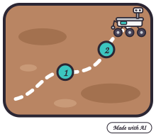

هێڵە سپییە پچڕپچڕەکە <b>ئەو ڕێگایەیە کە <bdi>Perseverance rover</bdi> بە ڕاستی پێیدا ڕۆیشتووە</b>.

وەک شوێنپێی سەر لم بیری لێ بکەرەوە. <bdi>rover</bdi> ئۆتۆمبێلێکی ڕۆبۆتییە لەسەر <bdi>Mars</bdi>. پێشتر بەم شوێنەدا ڕۆیشتووە، و ئەپەکە شوێنی تایەکانی وەک ئەو هێڵە سپییە پچڕپچڕە دەکێشێت.

- <b>بۆچی بە ناو بازنە ژمارەدارەکاندا تێدەپەڕێت؟</b> لە <bdi>zone Z2</bdi>دا، ناوی وێستگەکانی 1 و 3 و 4 بریتییە لە «<bdi>Rover stop, sol …</bdi>». ئەوانە ئەو شوێنانەن کە <bdi>rover</bdi> لێیان وەستاوە، بۆیە دەکەونە سەر ڕێگاکەی. (<bdi>sol</bdi> واتە ڕۆژێکی <bdi>Mars</bdi>.)
- <b>ئەمە ڕێگای ڕۆیشتنی <bdi>astronaut</bdi>ەکان نییە.</b> پێش ئەوەی پلان دابنێیت، پانێڵەکە دەڵێت «<bdi>no route yet</bdi>». کاتێک کرتە لە <b><bdi>Find safest route</bdi></b> دەکەیت، هێڵێکی نوێ بۆ <bdi>astronaut</bdi>ەکان دەردەکەوێت. لەسەر زەویی ئاسان سەوزە، و لەو شوێنانەی دەبێت ئاگادار بن زەردە. هەندێک بەشی ئەو هێڵەش پچڕپچڕە، بەڵام تەنها لەو شوێنانەی ڕادیۆ کار ناکات.
- <b>لە کوێوە هاتووە؟</b> لە لیستی شوێنەکانی <bdi>rover</bdi>ـەوە، کە <bdi>NASA/JPL</bdi> ئامادەی کردووە (سەرچاوەی زیادە <bdi>S1</bdi>).
- <b>دەتوانم بیشارمەوە؟</b> بەڵێ. تابی <b><bdi>Layers</bdi></b> بکەرەوە و <b>«<bdi>Perseverance path</bdi>»</b> بکوژێنەرەوە.

[↑ هەموو پرسیارەکان](#ku-toc)

---

## 2. <bdi>Perseverance</bdi> چییە؟

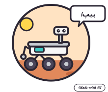

<b><bdi>Perseverance</bdi> ئۆتۆمبێلێکی ڕۆبۆتییە کە <bdi>NASA</bdi> ناردوویەتی بۆ <bdi>Mars</bdi>.</b>

- <b>چەند گەورەیە؟</b> نزیکەی هێندەی ئۆتۆمبێلێکی ڕاستەقینە. شەش تایەی هەیە.
- <b>کێ لێی دەخوڕێت؟</b> کەس تێیدا دانانیشێت. خەڵکی سەر زەوی لیستێک جووڵەی بۆ دەنێرن، و ڕۆبۆتەکە خۆی ئەنجامیان دەدات.
- <b>کەی گەیشتە ئەوێ؟</b> لە شوباتی 2021 لەسەر <bdi>Mars</bdi> نیشتەوە، لەناو چاڵێکی گەورەدا بە ناوی <b><bdi>Jezero crater</bdi></b>. ئەپەکەت هەمان ئەو شوێنە پیشان دەدات.
- <b>بۆچی لەوێیە؟</b> زۆر زۆر لەمەوبەر، <bdi>Jezero crater</bdi> دەریاچەیەکی پڕ لە ئاو بوو. لە شوێنێک ئاوی لێ بووبێت، لەوانەیە بوونەوەری زیندووی زۆر بچووکیشی لێ بووبێت. <bdi>Perseverance</bdi> بە دوای نیشانەکانی ئەواندا دەگەڕێت.
- <b>چی دەتوانێت بکات؟</b>
   - <b>کامێرای</b> هەیە، وەک چاو. وێنەی زۆر دەگرێت.
   - <b>دەستێکی ڕۆبۆتیی</b> هەیە (<bdi>robot arm</bdi>)، وەک دەست. دەتوانێت دەست لە بەردەکان بدات و لە نزیکەوە سەیریان بکات.
   - <b>دریلی</b> هەیە (<bdi>drill</bdi>). دەتوانێت پارچەیەکی بچووک لە بەرد ببڕێت و لە لوولەیەکی بچکۆلەدا هەڵیبگرێت، وەک دانانی گەنجینەیەک لەناو شووشەیەکدا.

> 📱 <b>لە ئەپەکەتدا</b>
>
> - <b>هێڵە سپییە پچڕپچڕەکە</b> پیشانی دەدات بە کوێدا ڕۆیشتووە.
> - <b>بازنەکانی «<bdi>Rover stop</bdi>»</b> ئەو شوێنانەن کە لێیان وەستاوە.
> - <b>وێنەکانی</b> ناو ئەپەکەت وێنە ڕاستەقینەکانی ئەون (سەرچاوەی <bdi>R5</bdi>).
> - <b><bdi>Cheyava Falls</bdi></b> (وێستگەی 2 لە <bdi>zone Z2</bdi>) بەردێکە کە لە 2024 دۆزییەوە. پەڵەی بچووکی پێوەیە، وەک پەڵەکانی پڵنگ، و زانایان دەیانەوێت بزانن ئایا ئەو پەڵانە لە بوونەوەری زیندووی زۆر بچووکەوە دروست بوون.
> - <b><bdi>Three Forks</bdi></b> (<bdi>zone Z1</bdi>) ئەو شوێنەیە کە 10 لە لوولە بەردییەکانی لەسەر زەوی جێهێشتووە. لەوانەیە ڕۆژێک گەشتێکی ئاسمانیی تر بێت و هەڵیانبگرێتەوە.

[↑ هەموو پرسیارەکان](#ku-toc)

---

## 3. ڕۆبۆتێک پێشتر لەوێیە. ئیتر بۆچی ئەم ئاڵنگارییە پێویستە؟

ڕۆبۆتەکە زۆر باشە، بەڵام <b>هێواشە</b>.

- <b>چاوەڕێی زەوی دەکات.</b> خەڵکی سەر زەوی پێی دەڵێن چی بکات. نامەیەک چەندین خولەکی پێدەچێت تا دەگاتە <bdi>Mars</bdi>، بۆیە ڕۆبۆتەکە زۆرجار چاوەڕێی فەرمانی داهاتوو دەکات.
- <b>هێواش دەجووڵێت.</b> زۆر بە ئاگاییەوە دەڕوات، بۆیە گەشتێکی کورت لەوانەیە چەند ڕۆژێکی پێبچێت.
- <b>ناتوانێت لە جێی خۆیدا بە ڕاستی بیر بکاتەوە.</b> مرۆڤێک دەتوانێت سەیری بەردێک بکات، بڵێت «ئۆی، ئەوە سەیرە!»، بچێتە لای و هەڵیبگێڕێتەوە، هەمووی لە چەند خولەکێکدا.

بۆیە <bdi>NASA</bdi> دەپرسێت: <b>«ڕۆژێک خەڵک لەسەر <bdi>Mars</bdi> پیاسە دەکەن. چۆن یارمەتییان بدەین بە سەلامەتی بڕۆن؟»</b>

مرۆڤ ڕۆبۆت نییە. پێویستیان بە هەوا هەیە بۆ هەناسەدان، ماندوو دەبن، جانتای قورس هەڵدەگرن، و دەبێت پێش تاریکبوون بگەڕێنەوە ماڵەوە. ئاڵنگارییەکە (<bdi>challenge</bdi>) داوای <b>نەخشەیەکی دروستکراو بۆ مرۆڤ</b> دەکات: نەخشەیەک کە ڕێگای سەلامەت پیشان بدات، بڵێت ڕادیۆ لە کوێ کار دەکات، و بڵێت کەی کەشوهەوا یان خۆر لەوانەیە مەترسیدار بن.

[↑ هەموو پرسیارەکان](#ku-toc)

---

## 4. مەبەست لە <bdi>crew</bdi> لەم پرۆژەیەدا چییە؟

<b><bdi>crew</bdi> واتە تیمی ئەو <bdi>astronaut</bdi>انەی دەچن بۆ پیاسەکە.</b>

لە ئەپەکەتدا، <bdi>crew</bdi> <b>2 <bdi>astronaut</bdi></b>ی تێدایە. هەمیشە پێکەوە دەڕۆن، وەک گرتنی دەستی یەکتر کاتێک لە شەقام دەپەڕنەوە. بەم شێوەیە، ئەگەر یەکێکیان بریندار بوو، ئەوی تر دەتوانێت یارمەتی بدات. ئەمە پێی دەوترێت <b><bdi>buddy rule</bdi></b>.

لە <b><bdi>Habitat</bdi></b>دا دەژین، ئەو «<bdi>H</bdi>»ـەی سەر نەخشەکە. ئەوە ماڵە بچکۆلەکەیانە لەسەر <bdi>Mars</bdi>. بەیانی لێی دەردەچن، سەردانی وێستگەکان دەکەن، و دەگەڕێنەوە ماڵەوە.

[↑ هەموو پرسیارەکان](#ku-toc)

---

## 5. <bdi>Cheyava Falls</bdi> چییە؟

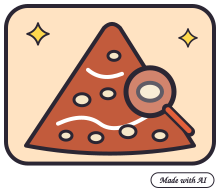

<b><bdi>Cheyava Falls</bdi> بەردێکی تایبەتە لەسەر <bdi>Mars</bdi>.</b>

- <b>لە کوێیە؟</b> لە دۆڵێکی کۆن و وشکی ڕووباردا. زۆر لەمەوبەر ئاو بەوێدا دەڕۆیشت. وێستگەی 2یە لەسەر نەخشەی <bdi>Bright Angel</bdi>.
- <b>ناوەکەی لە کوێوە هاتووە؟</b> <bdi>NASA</bdi> بە ناوی تاڤگەیەک لە <bdi>Grand Canyon</bdi>ی سەر زەوی ناوی لێ ناوە.
- <b>چەند گەورەیە؟</b> نزیکەی هێندەی مێزێکی بچووک، و شێوەی کەمێک لە سەری تیر دەچێت.
- <b>بۆچی تایبەتە؟</b> <b>پەڵەی زۆر بچووکی پێوەیە، وەک پەڵەکانی پڵنگ</b>: خاڵی کاڵی بچووک کە بازنەیەکی تاریک دەوری داون.
- <b>بۆچی پەڵەکان گرنگن؟</b> لەسەر زەوی، پەڵەی لەم جۆرە دەکرێت <b>بوونەوەری زیندووی زۆر بچووک</b> دروستیان بکەن، ئەوەندە بچووک کە بە چاو نابینرێن. بۆیە زانایان پرسیان: «ئایا بوونەوەری زیندووی زۆر بچووک لە زەمانێکی کۆندا ئەم پەڵانەیان لەسەر <bdi>Mars</bdi> دروست کردووە؟»
- <b>ڕۆبۆتەکە چی کرد؟</b> پارچەیەکی بچووکی لە بەردەکە دریل کرد و لە لوولەیەکدا پاشەکەوتی کرد.
- <b>ئێستا چی دەزانین؟</b> لە 2025دا، <bdi>NASA</bdi> وتی ئەم پارچەیە <b>یەکێکە لە باشترین نیشانەکان تا ئێستا</b> کە لەوانەیە جاران ژیان لەسەر <bdi>Mars</bdi> هەبووبێت. بەڵام <b>بەڵگە نییە</b>. لەوانەیە پەڵەکان بەبێ هیچ شتێکی زیندووش دروست بووبن.

### پەڵەکان چۆنن؟

ئەمە <b>بەردە ڕاستەقینەکەیە</b>، لە زۆر نزیکەوە. <bdi>NASA</bdi> بازنەیەکی سووری بە دەوری یەکێک لە پەڵەکاندا کێشاوە. سەیری دەوروبەری بکە: <b>زۆر خاڵی کاڵی بچووکی تر دەبینیت کە بازنەیەکی تاریک دەوری داون</b>.

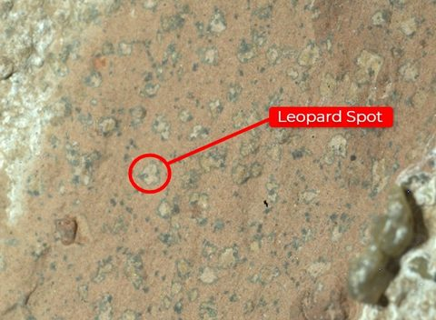

<b>پەڵەی پڵنگئاسا لەسەر <bdi>Mars</bdi></b> · بەشێک لە بەردی <bdi>Cheyava Falls</bdi>، کە کامێرای سەر قۆڵی ڕۆبۆتەکە لە زۆر نزیکەوە گرتوویەتی، لە 18ی تەممووزی 2024. بازنە سوورەکە و نووسینەکە هی <bdi>NASA</bdi>ن (<bdi>Leopard Spot</bdi> واتە پەڵەی پڵنگئاسا). هەر پەڵەیەک تەنها چەند ملیمەترێکە، لە دەنکە برنجێک بچووکترە.

وێنەی ڕاستەقینە (بڕاوە) · <bdi>WATSON camera (SHERLOC)</bdi> · <bdi>sol 1212</bdi> · <bdi>NASA/JPL-Caltech</bdi> · <bdi>PIA26368</bdi>

### بۆچی پێیان دەڵێن «پەڵەی پڵنگئاسا»؟

<b>پڵنگ</b> پشیلەیەکی گەورەی کێوییە. لە ئەفریقا و ئاسیا دەژی. مووە زەردەکەی پڕە لە پەڵەی ڕەش، و <b>زۆربەی پەڵەکان وەک ئەڵقەن</b>: لێوارەکەیان تاریکە و ناوەڕاستەکەیان کاڵترە. پەڵەکانی سەر بەردەکە کەمێک لەوە دەچن، بۆیە زانایان ناویان نان «پەڵەی پڵنگئاسا».

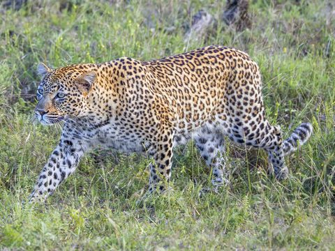

<b>پڵنگێکی ڕاستەقینە</b> · پڵنگێک بەناو گیادا دەڕوات لە پارکی نیشتمانیی <bdi>Kruger</bdi> لە ئەفریقای باشوور، لە نیسانی 2024. ناوی تاتیانایە و تەمەنی شەش ساڵ بوو.

وێنەی ڕاستەقینە (بڕاوە) · <bdi>Charles J. Sharp</bdi> · <bdi>Sharp Photography</bdi> · [<bdi>CC BY-SA 4.0</bdi>](https://creativecommons.org/licenses/by-sa/4.0/) · <bdi>via [Wikimedia Commons](https://commons.wikimedia.org/wiki/File:Leopard_(Panthera_pardus_pardus)_Kruger_2.jpg)</bdi>

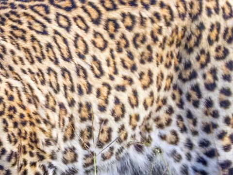

<b>مووی پڵنگ لە نزیکەوە</b> · لای هەمان پڵنگ. ئەڵقە تاریکەکان دەبینیت کە ناوەڕاستیان کاڵترە؟ ئێستا جارێکی تر سەیری بەردەکە بکەوە.

وێنەی ڕاستەقینە (لە وێنەی پڵنگەکەوە بڕاوە) · <bdi>Charles J. Sharp</bdi> · <bdi>Sharp Photography</bdi> · [<bdi>CC BY-SA 4.0</bdi>](https://creativecommons.org/licenses/by-sa/4.0/) · <bdi>via [Wikimedia Commons](https://commons.wikimedia.org/wiki/File:Leopard_(Panthera_pardus_pardus)_Kruger_2.jpg)</bdi>

> 📱 <b>لە ئەپەکەتدا</b>
>
> لەبەر ئەوەیە ئەپەکەت پیاسەیەک بۆ ئەوێ پلان دادەنێت. مرۆڤێک دەتوانێت لە هەموو لایەکەوە سەیری بەردەکە بکات، بەردەکانی دەوروبەری بپشکنێت، و باشترین پارچە هەڵبژێرێت بۆ ئەوەی بیهێنێتەوە بۆ زەوی.

[↑ هەموو پرسیارەکان](#ku-toc)

---

## 6. لوولە بەردییە بچکۆلەکانی ڕۆبۆتەکە چین؟

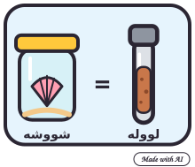

بە ئینگلیزی پێیان دەڵێن <b><bdi>sample tubes</bdi></b>.

### ڕۆبۆتەکە بەرد کۆ دەکاتەوە، وەک ئەوەی تۆ لە کەناری دەریا سەدەف کۆ دەکەیتەوە

وێنا بکە لە کەناری دەریایت. سەدەفێکی جوان دەدۆزیتەوە و دەتەوێت بیبەیتەوە ماڵەوە. بۆیە:

1. <b>هەڵیدەگریت.</b>
2. <b>دەیخەیتە ناو شووشەیەکی بچووکەوە.</b>
3. <b>سەرەکەی توند دادەخەیت</b>، بۆ ئەوەی نەکەوێتە دەرەوە و پیس نەبێت.

ڕۆبۆتەکەش لەسەر <bdi>Mars</bdi> هەمان کار دەکات:

1. <b>پارچەیەکی بچووک لە بەردێک دریل دەکات.</b> پارچەکە نزیکەی هێندەی پارچەیەک تەباشیر گەورەیە.
2. <b>پارچەکە دەخاتە ناو لوولەیەکی بچووکی کانزاییەوە.</b> ئەو لوولەیە «شووشەکە»یە.
3. <b>لوولەکە بە سەرێک دادەخات</b>، بۆ ئەوەی هیچ تۆز و هەوایەک نەچێتە ژوورەوە.

### لوولەکە چۆنە؟

ئەمە <b>لوولەیەکی ڕاستەقینەیە لەسەر <bdi>Mars</bdi></b>. لوولەیەکی کانزایی باریکی سپی و زەردە، نزیکەی هێندەی قەڵەمێکی مارکەر درێژە. پارچە بەردەکە لەناویدا داخراوە، بۆیە نایبینیت.

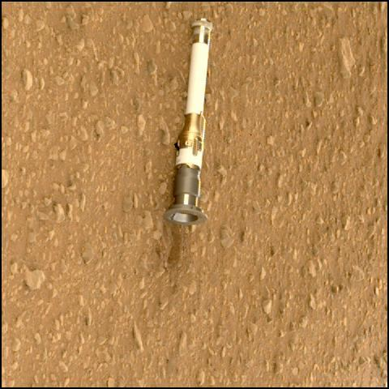

<b>لوولەیەکی ڕاستەقینە لەسەر <bdi>Mars</bdi></b> · یەکەم لوولە کە ڕۆبۆتەکە لە <bdi>Three Forks</bdi> دایناوە، لەسەر زەوی کەوتووە. کامێرای سەر قۆڵی ڕۆبۆتەکە ئەم وێنەیەی لە نزیکەوە گرتووە، لە 21ی کانوونی یەکەمی 2022.

وێنەی ڕاستەقینە · <bdi>WATSON camera (SHERLOC)</bdi> · <bdi>sol 653</bdi> · <bdi>NASA/JPL-Caltech</bdi>

### بۆچی بەردەکان هەڵدەگرێت؟

ڕۆبۆتەکە هەندێک ئامرازی هەیە بۆ سەیرکردنی بەرد. بەڵام لەسەر زەوی، زانایان <b>ئامێری زۆر گەورە و بەهێزیان</b> هەیە، ئەوەندە گەورە کە لەسەر ڕۆبۆتەکە جێیان نابێتەوە. ئەو ئامێرانە دەتوانن زۆر زیاتر ببینن.

بۆیە پلانەکە ئەمەیە: <b>ئێستا بەردەکان لەناو لوولەکاندا بمێننەوە، و ڕۆژێک بە فڕۆکەی ئاسمانی بهێنرێنەوە بۆ زەوی</b>، بۆ ئەوەی زانایان بە ئامێرە گەورەکان سەیریان بکەن.

> 📱 <b>پەیوەندیی بە <bdi>Three Forks</bdi>ەوە</b>
>
> زۆربەی لوولەکان هێشتا <b>لەناو ڕۆبۆتەکەدان</b>. بەڵام ڕۆبۆتەکە <b>10 لەم لوولە داخراوانەی لە <bdi>Three Forks</bdi> لەسەر زەوی دانا</b>، وەک جێهێشتنی چەند شووشەیەکی سەدەف لە شوێنێکی سەلامەت. لە ئەپەکەتدا، <bdi>astronaut</bdi>ەکان دەچنە ئەوێ و هەڵیان دەگرنەوە.

[↑ هەموو پرسیارەکان](#ku-toc)

---

## 7. <bdi>Three Forks</bdi> چییە؟

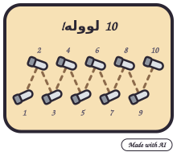

<b><bdi>Three Forks</bdi> شوێنێکە لەسەر <bdi>Mars</bdi> کە ڕۆبۆتەکە «سندووقێکی گەنجینە»ی تێدا لەسەر زەوی جێهێشتووە.</b>

لوولە بەردییە بچکۆلەکانی ڕۆبۆتەکەت لە پرسیاری 6 لە بیرە، ئەو «شووشانە»ی پارچە بەردیان تێدایە؟

- ڕۆبۆتەکە زۆر لوولەی <b>لەناو لەشی خۆیدا</b> هێشتەوە.
- بەڵام لە هەندێکیان <b>کۆپی</b>ی دروست کرد، و <b>10 لوولەی لەسەر زەوی</b> لە <bdi>Three Forks</bdi> دانا. ئەمە لە کۆتایی 2022 و سەرەتای 2023دا ڕوویدا.
- هەموویانی لە یەک کۆمەڵەدا دانەنا. <b>دوور لە یەکتر، یەک بە یەک، لە هێڵێکی درێژی زیگزاگیدا</b> دایناون، وەک جێهێشتنی کولیچە بە درێژایی ڕێگایەک.

ئەمە ئەو ڕۆژەیە کە ڕۆبۆتەکە <b>یەکەم لوولەی</b> دانا. سەیری ناوەڕاستی وێنەکە بکە: لوولەکە ئەو <b>هێڵە سپییە بچووکەیە لە سێبەری ڕۆبۆتەکەدا</b>. یەکێک لە تایەکانی ڕۆبۆتەکە لە خوارەوەی لای ڕاستە.

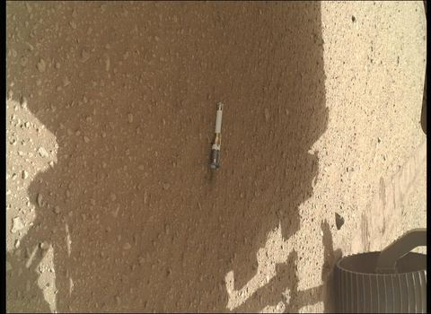

<b>یەکەم لوولە لە <bdi>Three Forks</bdi></b> · لە سێبەری ڕۆبۆتەکەدا لەسەر زەوی کەوتووە، لەو ڕۆژەی کە ڕۆبۆتەکە دایناوە (21ی کانوونی یەکەمی 2022). تایەیەکی ڕۆبۆتەکە لە خوارەوەی لای ڕاستە.

وێنەی ڕاستەقینە · <bdi>WATSON camera (SHERLOC)</bdi> · <bdi>sol 653</bdi> · <bdi>NASA/JPL-Caltech</bdi>

### بۆچی لەسەر زەوی جێیان دەهێڵێت؟

<b>ئەمە یەدەگە</b>، وەک هێشتنەوەی کلیلێکی یەدەگ لە ژێر ڕایەخی بەردەم دەرگا.

ئەگەر ڕۆژێک ڕۆبۆتەکە تێک بچێت، لوولەکانی ناوی گیر دەخۆن. بەڵام 10 لوولەکەی سەر زەوی هێشتا سەلامەتن. دواتر، گەشتێکی نوێ دەتوانێت بێت، <b>هەڵیانبگرێتەوە و بیانهێنێتەوە بۆ زەوی</b>. هێشتا کەس هەڵی نەگرتوونەتەوە. ئەمڕۆش هەر لەوێ کەوتوون.

ڕۆبۆتەکە لە یەکتری دوور خستنەوە، بۆ ئەوەی ئەگەر یەک شوێن کێشەی هەبوو (وەک ئەوەی تۆز دایپۆشێت)، لوولەکانی تر هێشتا باش بن.

> 📱 <b>لە ئەپەکەتدا</b>
>
> ئەمە <b><bdi>zone Z1</bdi></b>ـە. <b>10 وێستگەی</b> هەیە، یەکێک بۆ هەر لوولەیەک.
>
> <bdi>crew</bdi> لە لوولەیەکەوە بۆ لوولەیەکی تر دەڕۆن و <b>هەڵیان دەگرنەوە</b>. ئەپەکە لە کاتی ڕۆیشتندا دەژمێرێت: «<bdi>tubes picked up 1 of 10, 2 of 10…</bdi>». وەک یاریی گەڕان بە دوای گەنجینەدا وایە لەسەر <bdi>Mars</bdi>!

> 📝 <b>تێبینییەکی ڕاستگۆیانە</b>
>
> ئێمە شوێنی وردی هەر لوولەیەک نازانین. ئەپەکە هەر وێستگەیەک لەو شوێنە دادەنێت کە ڕۆبۆتەکە <b>لێی وەستاوە</b> کاتێک ئەو لوولەیەی داناوە. ئەمە مەزەندەیەکی باشە، بەڵام تەنها مەزەندەیە، بۆیە پرۆژەکە نیشانەی <b>«پێویستە بپشکنرێت»</b>ی لێ داوە (<bdi>assumption A14</bdi>).

[↑ هەموو پرسیارەکان](#ku-toc)

---

## 8. <bdi>Bright Angel</bdi> چییە؟

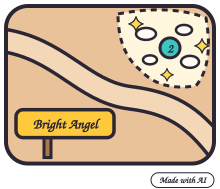

<b><bdi>Bright Angel</bdi> ناوچەیەکی بچووکە لەسەر <bdi>Mars</bdi>، لەناو <bdi>Jezero crater</bdi>ی گەورەدا.</b>

پارکێکی گەورە بهێنە بەرچاوت. <bdi>Jezero crater</bdi> <b>هەموو پارکەکەیە</b>. <bdi>Bright Angel</bdi> <b>گۆشەیەکی پارکەکەیە</b>. <bdi>Cheyava Falls</bdi>، بەردە پەڵەدارەکە، <b>بەردێکی تایبەتە لەو گۆشەیەدا</b>.

### بۆچی ناوی «<bdi>Bright Angel</bdi>»ـە؟

- <b>«<bdi>Bright</bdi>»</b> واتە ڕووناک: زۆرێک لە بەردەکانی ئەوێ <b>ڕەنگیان کاڵە</b>، کاڵترن لە زەوییە تاریکەکەی دەوروبەریان، بۆیە ڕووناک دەردەکەون.
- <b>ناوەکە</b> لە جۆگەلەیەک و ڕێگایەکی پیادەڕەوی لە <b><bdi>Grand Canyon</bdi></b>ی سەر زەوییەوە هاتووە. <bdi>NASA</bdi> حەز دەکات شوێنەکانی سەر <bdi>Mars</bdi> بە ناوی شوێنەکانی سەر زەوی ناو بنێت، وەک ئەوەی هاوڕێیەکی نوێ بە ناوی کەسێکی ناسراوەوە ناو بنێیت.

### چی تایبەتە لەوێ؟

- زۆر لەمەوبەر، <b>ڕووبارێک</b> بەم شوێنەدا دەڕۆیشت. ئەمڕۆ وشکە، بەڵام ڕووبارەکە دۆڵێکی هەڵکەندووە، وەک خلیسکێنەیەک کە لە زەویدا هەڵکەنرابێت.
- لە شوێنێک ئاوی لێ بووبێت، لەوانەیە <b>بوونەوەری زیندووی زۆر بچووکی</b> لێ بووبێت.
- ڕۆبۆتەکە لە <b>2024</b>دا چووە ئەوێ و <b>بەردی <bdi>Cheyava Falls</bdi></b>ی دۆزییەوە، بە پەڵە پڵنگئاساکانییەوە.

> 📱 <b>لە ئەپەکەتدا</b>
>
> ئەمە <b><bdi>zone Z2</bdi></b>ـە، زۆنی سەرەکیی پرۆژەکەت. <b>4 وێستگەی</b> هەیە:
>
> 1. <b><bdi>Rover stop, sol 1159</bdi></b>: شوێنێک کە ڕۆبۆتەکە لێی وەستاوە
> 2. <b><bdi>Cheyava Falls rock</bdi></b>: بەردە پەڵەدارەکە
> 3. <b><bdi>Rover stop, sol 1231</bdi></b>: شوێنێکی تری وەستان
> 4. <b><bdi>Rover stop, sol 1254</bdi></b>: شوێنێکی تری وەستان
>
> <bdi>crew</bdi> لە <b><bdi>Habitat (H)</bdi></b> دەردەچن، دەڕۆن بۆ ئەم وێستگانە، لە نزیکەوە سەیری بەردە پەڵەدارەکە دەکەن، و بە سەلامەتی دەگەڕێنەوە ماڵەوە. ئەپەکە سەلامەتترین ڕێگایان بۆ دەدۆزێتەوە.

[↑ هەموو پرسیارەکان](#ku-toc)

---

## 9. <bdi>Jezero crater</bdi> چییە؟

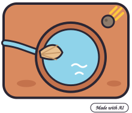

<b><bdi>Jezero crater</bdi> چاڵێکی خڕی زەبەلاحە لەسەر <bdi>Mars</bdi>، شێوەی وەک کاسە وایە.</b>

### چۆن دروست بوو؟

قەت بەردێکت فڕێ داوەتە ناو لمەوە؟ چاڵێکی بچووکی خڕ جێدەهێڵێت.

زۆر زۆر لەمەوبەر، <b>بەردێکی گەورە لە بۆشایی ئاسمانەوە بەر <bdi>Mars</bdi> کەوت</b>. چاڵێکی دروست کرد، بەڵام چاڵێکی <b>زەبەلاح</b>. ئەوەندە پانە کە کەسێکی گەورە ئەگەر هەموو ڕۆژەکە بە پێ بڕوات، ناتوانێت لەم سەرەوە بگاتە ئەو سەری. ئەو چاڵە <bdi>Jezero crater</bdi>ـە.

### بۆچی تایبەتە؟

زۆر زۆر لەمەوبەر، <bdi>Mars</bdi> لە ئێستا تەڕتر بوو.

1. <b>کاسەکە پڕ بوو لە ئاو</b> و بوو بە <b>دەریاچە</b>، وەک ئەوەی باران سەتڵێک پڕ بکات.
2. <b>ڕووبارێک ڕژایە ناو دەریاچەکەوە.</b>
3. ڕووبارەکە <b>لم و قوڕی</b> لەگەڵ خۆی دەهێنا. لەو شوێنەی گەیشتە دەریاچەکە، بە <b>شێوەی بادەوەشێن</b> (<bdi>delta</bdi>) دایدەنان. وەک ئەوە وایە ئاو لە کوپێکەوە بڕژێنیتە ناو سندووقێکی لمەوە: قوڕەکە وەک بادەوەشێن بڵاو دەبێتەوە.

ئەمڕۆ ئاوەکە نەماوە. بەڵام بادەوەشێنە قوڕینەکە هێشتا ماوە، بووە بە بەرد.

لە شوێنێک ئاوی لێ بووبێت، لەوانەیە <b>بوونەوەری زیندووی زۆر بچووکی</b> لێ بووبێت. بۆیە <bdi>NASA</bdi> بیری کردەوە: «ئەم دەریاچە کۆنە شوێنێکی نایابە بۆ گەڕان بە دوای نیشانەکاندا!» لەبەر ئەوە <b><bdi>Perseverance</bdi> لە 2021دا لێرە نیشتەوە</b>.

### ناوەکەی لە کوێوە هاتووە؟

بە ناوی شارۆچکەیەکی بچووکی سەر زەوی ناونراوە، لە وڵاتێک بە ناوی بۆسنە و هەرزەگۆڤینا. لە زمانی ئەو وڵاتەدا، <b>«<bdi>jezero</bdi>» واتە «دەریاچە»</b>. ناوێکی گونجاوە بۆ دەریاچەیەکی کۆن!

> 📱 <b>لە ئەپەکەتدا</b>
>
> <bdi>Jezero crater</bdi> <b>هەموو یاریگاکەیە</b>. هەردوو زۆنی پیاسەکەت لەناویدان:
>
> - <b><bdi>Three Forks (Z1)</bdi></b>: ئەو شوێنەی ڕۆبۆتەکە 10 لوولە بەردییەکەی تێدا جێهێشت
> - <b><bdi>Bright Angel (Z2)</bdi></b>: ئەو شوێنەی بەردە پەڵەدارەکەی <bdi>Cheyava Falls</bdi>ی لێیە
>
> لە ئەپەکەدا، دەتوانیت نەخشەکە بچووک بکەیتەوە (<bdi>zoom out</bdi>) بۆ بینینی <b>هەموو <bdi>crater</bdi>ەکە</b> لەگەڵ هەردوو زۆنەکە کە نیشانە کراون، و زیاتر بچووکی بکەیتەوە بۆ بینینی <b>هەموو <bdi>Mars</bdi></b>.

[↑ هەموو پرسیارەکان](#ku-toc)

---

## 10. <bdi>sol</bdi> چییە؟

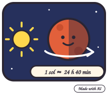

<b><bdi>sol</bdi> واتە یەک ڕۆژ لەسەر <bdi>Mars</bdi>.</b>

### ڕۆژ چییە؟

ڕۆژ ئەو ماوەیەیە کە لە <b>بەیانییەکەوە تا بەیانیی دواتر</b> دەخایەنێت. ئەمە ڕوودەدات چونکە هەسارەکە <b>وەک تۆپێک بە دەوری خۆیدا دەسوڕێتەوە</b>. کاتێک لاکەی تۆ ڕووی لە خۆرە، ڕۆژە. کاتێک ڕووی لێ وەردەگێڕێت، شەوە.

- <b>زەوی</b> <b>24 کاتژمێری</b> پێدەچێت تا یەک جار بسوڕێتەوە.
- <b><bdi>Mars</bdi></b> کەمێک هێواشتر دەسوڕێتەوە. نزیکەی <b>24 کاتژمێر و 40 خولەکی</b> پێدەچێت.

کەواتە ڕۆژێکی <bdi>Mars</bdi> <b>نزیکەی 40 خولەک درێژترە</b> لە ڕۆژێکی زەوی. ئەوەش کاتێکی زیاترە بۆ یاری!

### بۆچی وشەیەکی تایبەت؟

ئەگەر کەسێک بڵێت «3 ڕۆژ»، لەوانەیە بپرسیت: «ڕۆژی زەوی یان ڕۆژی <bdi>Mars</bdi>؟» بۆ ئەوەی تێکەڵ نەبن، زانایان بە ڕۆژی <bdi>Mars</bdi> دەڵێن <b>«<bdi>sol</bdi>»</b>. لە «<bdi>Sol</bdi>»ـەوە هاتووە، کە ناوێکی کۆنی خۆرە.

### ڕۆبۆتەکە چۆن <bdi>sol</bdi>ەکان دەژمێرێت؟

وەک ئەوەی تەمەنی منداڵێکی ساوا بە ڕۆژ بژمێریت:

- ئەو ڕۆژەی ڕۆبۆتەکە لەسەر <bdi>Mars</bdi> <b>نیشتەوە</b>، <b><bdi>sol 0</bdi></b>ـە.
- ڕۆژی دواتری <bdi>Mars</bdi> <b><bdi>sol 1</bdi></b>ـە، پاشان <b><bdi>sol 2</bdi></b>، و بەم شێوەیە.

کەواتە <b>«<bdi>sol 1159</bdi>»</b> واتە «<b>ڕۆژی 1159ـەمی</b> ڕۆبۆتەکە لەسەر <bdi>Mars</bdi>». ئەمە کەمێک زیاترە لە <b>3 ساڵی زەوی</b> دوای نیشتنەوەی، نزیکەی ناوەڕاستی 2024.

> 📱 <b>لە ئەپەکەتدا</b>
>
> لەسەر نەخشەکەت، <b>«<bdi>Rover stop, sol 1159</bdi>»</b> واتە «<b>ڕۆبۆتەکە لە ڕۆژی 1159ـەمی خۆیدا لەسەر <bdi>Mars</bdi> لێرە وەستا</b>». ژمارەی <bdi>sol</bdi>ەکان پێت دەڵێن ڕۆبۆتەکە <b>کەی</b> لە هەر شوێنێک بووە.

> 💡 <b>زانیارییەکی سەرنجڕاکێش!</b>
>
> کاتێک ڕۆبۆتەکە تازە نیشتبووەوە، هەندێک لە کارمەندانی <bdi>NASA</bdi> لەسەر زەوی بە <b>کاتی <bdi>Mars</bdi></b> دەژیان. هەموو ڕۆژێک نزیکەی 40 خولەک درەنگتر لە ڕۆژی پێشوو دەهاتنە سەر کار، بۆ ئەوەی ڕۆژەکانیان لەگەڵ <bdi>sol</bdi>ەکانی ڕۆبۆتەکە بگونجێت!

[↑ هەموو پرسیارەکان](#ku-toc)

---

## 11. <bdi>Habitat</bdi> چییە؟

<b><bdi>Habitat</bdi> ماڵی <bdi>astronaut</bdi>ەکانە لەسەر <bdi>Mars</bdi>.</b> لەسەر نەخشەکەت، ئەو بازنەیەیە کە پیتی <b>«<bdi>H</bdi>»</b>ی تێدایە.

### بۆچی پێویستیان بە ماڵ هەیە؟

<bdi>Mars</bdi> <b>شوێنێکی دۆستانە نییە</b> بۆ مرۆڤ:

- <b>زۆر زۆر ساردە</b>، زۆر ساردتر لە فریزەر.
- هەواکەی <b>ئەوەندە تەنکە کە ناتوانیت هەناسەی پێ بدەیت</b>.
- خۆر <b>تیشکی نەبینراو</b> (<bdi>radiation</bdi>) دەنێرێت کە دەتوانێت زیان بە مرۆڤ بگەیەنێت.

لە دەرەوە، <bdi>astronaut</bdi>ەکان دەبێت <b><bdi>spacesuit</bdi>ی گەورە</b> لەبەر بکەن، وەک ماڵێکی بچکۆلە کە لەبەری دەکەیت. لەناو <bdi>Habitat</bdi>دا سەلامەتن. دەتوانن <bdi>spacesuit</bdi>ەکانیان دابکەنن، هەناسە بدەن، بخۆن، بخەون و گەرم بمێننەوە.

### <bdi>Habitat</bdi> لە ئەپەکەتدا چی دەکات؟

1. <b>پیاسەکە لەوێ دەست پێدەکات و لەوێ کۆتایی دێت.</b> <bdi>crew</bdi> بەیانی لە «<bdi>H</bdi>» دەردەچن، سەردانی وێستگەکان دەکەن، و دەبێت <b>پێش تاریکبوون بگەڕێنەوە ماڵەوە</b> و پێش ئەوەی هەواکەیان کەم بێتەوە. ئەپەکە ئەمەیان بۆ دەپشکنێت.
2. <b>ئەوێ شوێنی پلاندانانیانە.</b> شاشەی <bdi>Plan</bdi> وەک تابلێتێکە کە <bdi>crew</bdi> <b>ڕۆژی پێشتر لەناو <bdi>Habitat</bdi>دا</b> بەکاری دێنن: «سبەی بچینە کوێ؟ سەلامەتە؟»

### ئەپەکە چۆن شوێنەکەی هەڵبژارد؟

ئەمە بەشە زیرەکەکەیە. ئەپەکە بە دوای شوێنێکدا گەڕا کە ئەم دوو شتەی تێدا بێت:

1. <b>زەویی تەخت</b>، بۆ ئەوەی ماڵەکە لار نەبێتەوە، وەک دروستکردنی قەڵای لم لەسەر لمی تەخت، نەک لەسەر لێژی.
2. <b>پەیوەندیی ڕادیۆیی باش لەگەڵ ڕێگای پیاسەکە.</b> ڕادیۆکە ڕێگە بە <bdi>astronaut</bdi>ەکان دەدات قسە لەگەڵ هاوڕێکانیان لە ماڵەوە بکەن. ڕادیۆ وەک تیشکی چرای دەستی وایە: بە هێڵی ڕاست دەڕوات (<bdi>line of sight</bdi>)، و <b>گردەکان ڕێگری لێ دەکەن</b>، وەک کاتێک لە یاریی خۆشاردنەوەدا لە پشت دیوارێک خۆت دەشاریتەوە.

سەرەتا، ئەپەکە تەنها تەختترین شوێنی هەڵبژارد. بەڵام لەوێوە، گردەکان ڕێگرییان لە ڕادیۆکە کرد بۆ زۆربەی پیاسەکە: بۆ <b>79 خولەک لە 90 خولەکەکە</b>، کەس نەیدەتوانی قسە لەگەڵ ماڵەوە بکات. بۆیە ئێستا ئەپەکە شوێنێک هەڵدەبژێرێت کە <b>بەسی تەخت بێت و هەروەها بتوانێت</b> تا دەکرێت زۆرترینی ڕێگاکە «ببینێت».

> 📝 <b>تێبینییەکی ڕاستگۆیانە</b>
>
> <b>هێشتا هیچ ماڵێکی ڕاستەقینە لەسەر <bdi>Mars</bdi> نییە.</b> هیچ مرۆڤێک هەرگیز نەچووەتە ئەوێ. <bdi>Habitat</bdi>ی ناو ئەپەکەت <b>خەیاڵییە</b>، پلانێکە بۆ داهاتوو. پرۆژەکە شوێنەکەی وەک مەزەندەیەک نیشانە کردووە کە دواتر بپشکنرێت (<bdi>assumption A6</bdi>).

[↑ هەموو پرسیارەکان](#ku-toc)

---

## 12. ناوچە سوور و زەردەکان چین؟

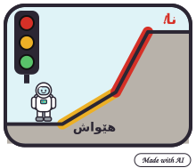

<b>پیشانی دەدەن زەوی لە کوێ لێژە، وەک لای گردێک.</b> لەسەر نەخشەکەت، ناوی ئەم <bdi>layer</bdi>ـە <b>«<bdi>Steep ground</bdi>»</b>ـە.

### «لێژ» (<bdi>slope</bdi>) واتە چی؟

بەم شێوەیە بیر لە زەوی بکەرەوە:

- <b>زەویی ژوورێک</b> تەختە. ڕۆیشتن ئاسانە.
- <b>گردێک</b> لارە. ڕۆیشتن قورسترە.
- <b>خلیسکێنەی یاریگا</b> زۆر لارە. بە ئاسانی دەتوانیت بخلیسکێیت.

تا زەوی لارتر بێت، ڕۆیشتن لەسەری قورستر و مەترسیدارترە.

### ڕەنگەکان واتای چین؟

وەک گڵۆپی هاتوچۆ وایە:

- ⬜ <b>بێ ڕەنگ (تەنها بەردی خۆڵەمێشی):</b> زەویی کەم‌لێژ. <b>ئاسایی بڕۆ.</b>
- 🟨 <b>زەرد:</b> لێژ، وەک گردێکی گەورە. <b>ئاگادار بە و هێواش بڕۆ.</b> (<bdi>15°</bdi> تا <bdi>25°</bdi>)
- 🟥 <b>سوور:</b> زۆر لێژ، نزیکەی وەک پلیکانە یان خلیسکێنە. <b>مەچۆ ئەوێ!</b> (زیاتر لە <bdi>25°</bdi>)

### بۆچی زەویی لێژ لەسەر <bdi>Mars</bdi> مەترسیدارە؟

<bdi>astronaut</bdi>ەکان <b><bdi>spacesuit</bdi>ی گەورە و قەبە</b> لەبەر دەکەن:

- لەناو <bdi>spacesuit</bdi>دا <b>بینینی پێی خۆت</b> قورسە.
- <bdi>spacesuit</bdi> <b>چەمانەوە و ڕاگرتنی هاوسەنگی</b> قورس دەکات.
- لم و بەردی بچووک دەتوانن <b>لە ژێر پێڵاوەکانتدا بخلیسکێن</b>.
- ئەگەر بکەویت، لەوانەیە <bdi>spacesuit</bdi>ەکەت <b>بدڕێت</b>، و ئەو هەوایەی هەناسەی پێ دەدەیت لەناو <bdi>spacesuit</bdi>ەکەدایە.

### ئەپەکە چۆن ڕەنگەکان بەکار دێنێت؟

کاتێک کرتە لە <b>«<bdi>Find safest route</bdi>»</b> دەکەیت، ئەپەکە ڕێگای <bdi>astronaut</bdi>ەکان دەدۆزێتەوە:

- <b>هەرگیز بە ناو سووردا ناڕوات</b>. بە دەوریدا دەسوڕێتەوە، وەک ڕۆیشتن بە دەوری چاڵە ئاوێکدا.
- لەسەر <b>زەرد</b>، <b>هێواشتر</b> دەڕوات، بۆیە ئەپەکە <b>کاتی زیاتر</b> بە بەشە زەردەکان دەدات (نزیکەی یەک و نیو هێندە).

### ڕەنگەکان لە کوێوە هاتوون؟

لە <b>نەخشەیەکی بەرزیی</b> (<bdi>height map</bdi>) زۆر وردی <bdi>Mars</bdi>ەوە، کە کامێرایەکی سەر کەشتییەکی ئاسمانی دروستی کردووە کە بە دەوری <bdi>Mars</bdi>دا دەسوڕێتەوە (<bdi>orbiter</bdi>). لە <bdi>Mars Trek</bdi>ـەوە هاتووە، سەرچاوەی <b><bdi>R1</bdi></b>. ئەپەکە دەپشکنێت هەر پارچەیەکی بچووکی زەوی چەند لارە، نزیکەی هەر 2 هەنگاو جارێک.

بۆ ئەوەی دڵنیا بین نەخشەکە ڕاست دەڵێت، پرۆژەکە بەراوردی کرد لەگەڵ <b>لاربوونی خودی ڕۆبۆتەکە</b> لە 79 شوێن کە بە ڕاستی لێیان وەستاوە. زۆر لە یەک دەچوون، بە تێکڕایی تەنها نزیکەی <b><bdi>2°</bdi></b> جیاوازییان هەبوو.

> 📱 <b>لە ئەپەکەتدا</b>
>
> دەتوانیت ڕەنگەکان لە تابی <b><bdi>Layers</bdi></b>دا پیشان بدەیت یان بیانشاریتەوە.

[↑ هەموو پرسیارەکان](#ku-toc)

---

## 13. «<bdi>Suggest order</bdi>» چی دەکات؟

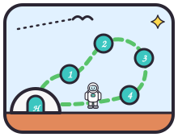

وا دابنێ لە ماڵێکدا دەژیت، و ئەمڕۆ دەتەوێت سەردانی چوار هاوڕێت بکەیت، پاشان بگەڕێیتەوە ماڵەوە.

دەتوانیت بە هەر ڕیزێک سەردانیان بکەیت. بەڵام ئەگەر سەرەتا بچیت بۆ لای هاوڕێیەکی دوور، پاشان بگەڕێیتەوە نزیک ماڵەکەت، پاشان دیسان بچیتەوە دوور، قاچەکانت زۆر ماندوو دەبن. 😩

<b>«<bdi>Suggest order</bdi>» یارمەتیدەرێکە کە ڕیزێکی زیرەکانە بۆت هەڵدەبژێرێت.</b> دەڵێت: «سەرەتا بچۆ بۆ لای نزیکترین هاوڕێ. پاشان بۆ لای نزیکترینی دواتر. پاشان ئەوەی دواتر. پاشان بگەڕێوە ماڵەوە.» بەم شێوەیە کەمتر دەڕۆیت. 🚶

### لەسەر <bdi>Mars</bdi>

- 🏠 ماڵەکەت = <b><bdi>Habitat</bdi></b>
- 👫 هاوڕێکانت = <b>وێستگەکان</b> (<bdi>stops</bdi>: 1، 2، 3، 4)

بەڵام ئەم یارمەتیدەرە کەمێک ساویلکەیە. لەسەر نەخشەکە <b>هێڵی ڕاست</b> دەکێشێت، وەک باڵندەیەک کە دەفڕێت. گردە گەورەکان و شوێنە سوورە مەترسیدارەکان نابینێت. بۆیە دوای ئەوەی ڕیزەکە هەڵدەبژێرێت، کرتە لە <b>«<bdi>Find safest route</bdi>»</b> دەکەیت. ئەوە ڕێگا ڕاستەقینە و سەلامەتەکە بۆ پێیەکانت دەدۆزێتەوە. 🛡️

و <b>هێشتا تۆ سەرۆکیت</b>: ئەگەر ڕیزەکەت بە دڵ نەبوو، دەتوانیت خۆت وێستگەکان بە تیرەکانی ↑ و ↓ بجووڵێنیت.

> 📱 <b>لە ئەپەکەتدا</b>
>
> دوگمەی <b>«<bdi>Suggest order</bdi>»</b> لە تابی <b><bdi>Stops</bdi></b>دایە. کاتێک <b>3 وێستگە یان زیاتر</b>ت هەبێت کار دەکات. تەنها <b>ڕیزی</b> وێستگەکان دەگۆڕێت: وێستگە زیاد یان کەم ناکات، و خولەکەکانیان ناگۆڕێت. دوای ئەوە، کرتە لە <b>«<bdi>Find safest route</bdi>»</b> بکە.

[↑ هەموو پرسیارەکان](#ku-toc)

---

## 14. «کات و یەدەگ» چییە؟

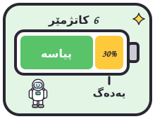

<b>«<bdi>Time and reserve</bdi>» دەپشکنێت کە پیاسەکە زۆر درێژ نەبێت، و هەمیشە هەندێک کات بمێنێتەوە.</b>

### پیاسەکە سنووری کاتی هەیە

<bdi>astronaut</bdi>ێک تەنها بۆ <b>ماوەیەکی سنووردار</b> دەتوانێت بە <bdi>spacesuit</bdi>ەوە لە دەرەوە بمێنێتەوە. هەوا و ئاو و پاترییەکانی <bdi>spacesuit</bdi> تەنها بۆ ماوەیەک بەش دەکەن، و مرۆڤیش ماندوو دەبێت. لە ئەپەکەدا، پیاسەیەک (<bdi>EVA</bdi>) ناتوانێت لە <b>6 کاتژمێر</b> (360 خولەک) زیاتر بێت.

### یەدەگ چییە؟

بیر لە قوتووە شەربەتێک بکەرەوە لە گەشتێکی قوتابخانەدا. هەمووی لە ڕێگای چوونەکەدا ناخۆیتەوە. هەندێکی دەهێڵیتەوە بۆ ڕێگای گەڕانەوە، و بۆ کاتێک شتێک بە هەڵەدا دەچێت.

<b>یەدەگ</b> (<bdi>reserve</bdi>) ئەو کاتە «هەڵگیراوە»یە. ئەپەکە هەمیشە لانیکەم <b>30%</b>ی ئەو 6 کاتژمێرە بەکارنەهاتوو دەهێڵێتەوە: نزیکەی <b>1 کاتژمێر و 48 خولەک</b>. ئەوە بۆ شتی چاوەڕواننەکراوە: پارچەیەکی لماوی و هێواش، ئامێرێکی شکاو، هاوڕێیەکی ماندوو، یان ڕێگای گەڕانەوە.

### ڕەنگەکان واتای چین؟

- 🟩 <b>سەوز:</b> پلانەکە لانی زۆر 70%ی کاتەکە بەکار دێنێت (<b>252 خولەک یان کەمتر</b>). هەموو یەدەگەکە ماوە.
- 🟨 <b>زەرد:</b> پلانەکە لەناو 6 کاتژمێردا جێی دەبێتەوە، بەڵام <b>لە یەدەگەکە دەخوات</b>. ئاگادار بە.
- 🟥 <b>سوور:</b> پلانەکە <b>لە 6 کاتژمێر درێژترە</b>. وێستگەیەک لاببە یان وێستگەکان کورتتر بکە.

بۆ نموونە: <b>221 خولەک</b> پلان کراوە، و <b>139 خولەک (38%)</b> ماوەتەوە. 38% لە 30% زیاترە، بۆیە سەوزە.

### کاتەکانی گەڕانەوە (<bdi>Turn-back times</bdi>)

ئەپەکە هەروەها <b>دواترین کات بۆ جێهێشتنی دوا وێستگە</b> بە <bdi>crew</bdi> دەڵێت، بە شێوەیەک کە هەموو یەدەگەکە بمێنێتەوە. وەک ئەوە وایە دایک یان باوکێک بڵێت: «دەبێت تا کاتژمێر 4 پارکەکە جێبهێڵین.»

> 📝 <b>تێبینییەکی ڕاستگۆیانە</b>
>
> 6 کاتژمێر و 30% <b>ژمارەی پلاندانانن</b> کە بۆ ئەم پرۆژەیە هەڵبژێردراون. هێشتا پێویستە شارەزایان بیانپشکنن (<bdi>assumptions A4</bdi> و <bdi>A5</bdi>، بە نیشانەی «<bdi>to verify</bdi>»).

[↑ هەموو پرسیارەکان](#ku-toc)

---

## 15. پەیوەندیی ڕادیۆیی لەگەڵ <bdi>Habitat</bdi> چییە؟

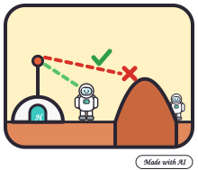

<b>«<bdi>Radio contact with the habitat</bdi>» دەپشکنێت کە <bdi>astronaut</bdi>ەکان هەمیشە بتوانن بە ڕادیۆ قسە لەگەڵ <bdi>Habitat</bdi> بکەن.</b>

### ڕادیۆکە چۆن کار دەکات؟

<bdi>Habitat</bdi> <b>ئەنتێنێکی</b> ڕادیۆی لەسەرە، نزیکەی <b>3 مەتر</b> بەرز. <bdi>astronaut</bdi>ەکان ڕادیۆیان لەناو <bdi>spacesuit</bdi>ەکانیاندا هەیە.

ڕادیۆ وەک تیشکی چرای دەستی وایە: بە <b>هێڵی ڕاست</b> دەڕوات. ئەگەر <b>گردێک</b> لە نێوان تۆ و ماڵەکەدا بێت، گردەکە ڕێگری لێ دەکات، وەک خۆشاردنەوە لە پشت دیوارێک لە یاریی خۆشاردنەوەدا. ئەو کاتە کەس لە ماڵەوە گوێی لێت نابێت.

### ئەپەکە چی دەپشکنێت؟

ئەپەکە بە درێژایی هەموو ڕێگاکە، کەم کەم دەڕوات و هەموو جارێک دەپرسێت: «لێرەوە، دەتوانم ئەنتێنەکە بە هێڵێکی ڕاست ببینم؟» زانایان پێی دەڵێن <b><bdi>line of sight</bdi></b> (هێڵی بینین).

- 🟩 <b>سەوز:</b> ڕادیۆ بۆ <b>هەموو پیاسەکە</b> هەیە.
- 🟨 <b>زەرد:</b> چەند <b>پارچەیەکی کورت</b> بێ ڕادیۆ. لەوێ پێکەوە بمێننەوە.
- 🟥 <b>سوور:</b> <b>زیاتر لە 15 خولەک</b> بە یەکجاری بێ ڕادیۆ. وێستگەیەک بجووڵێنە، یان یارمەتیدەرێکی ڕادیۆیی (<bdi>relay</bdi>) لەسەر گردێک دابنێ.

لەسەر شاشەکەت، ئەپەکە <b>«<bdi>3 short stretches</bdi>»</b>ی دۆزییەوە کە ڕادیۆیان تێدا نییە، بۆیە زەردە. هاوڕێکان دەبێت لەوێ پێکەوە بمێننەوە.

<bdi>Habitat</bdi> لەسەر زەوییەکی تەخت دانرا کە بتوانێت تا دەکرێت زۆرترینی پیاسەکە «ببینێت» (بڕوانە [پرسیاری 11](#ku-habitat)).

> 📝 <b>تێبینییەکی ڕاستگۆیانە</b>
>
> ئەنتێنی 3 مەتری و 15 خولەکەکە <b>ژمارەی پلاندانانن</b> و دواتر دەپشکنرێن (<bdi>assumptions A7</bdi> و <bdi>A9</bdi>).

[↑ هەموو پرسیارەکان](#ku-toc)

---

## 16. «<bdi>Sun activity</bdi>» چییە؟

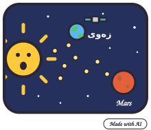

<b>دەپشکنێت ئایا خۆر زریانی هەیە.</b>

### زریان لە خۆرەوە؟

هەندێک جار خۆر هەورێک لە <b>پارچەی زۆر بچووک و زۆر خێرا</b> (<bdi>particles</bdi>) دەهاوێژێت. پێی دەڵێن <b>زریانی پارچەی خۆر</b> (<bdi>solar particle storm</bdi>). ئەم پارچانە دەتوانن بە ناو <bdi>spacesuit</bdi>دا تێپەڕن و <b>زیان بە لەشی مرۆڤ بگەیەنن</b>.

لەسەر زەوی، هەوا ئەستوورەکەمان و قەڵغانە مەغناتیسییە نەبینراوەکەی هەسارەکەمان زۆربەیان ڕادەگرن. <bdi>Mars</bdi> <b>هەوایەکی زۆر تەنکی هەیە و قەڵغانێکی مەغناتیسی بە دەوری هەموو هەسارەکەدا نییە</b>. بۆیە لەسەر <bdi>Mars</bdi>، کاتێک زریانێک دێت، مرۆڤ دەبێت بچێتە شوێنێکی سەلامەت.

### ئەپەکە هەواڵەکان لە کوێوە دەهێنێت؟

- <b>مانگە دەستکردەکانی <bdi>NOAA GOES</bdi></b> لە نزیک زەوییەوە چاودێریی خۆر دەکەن. پارچە خێراکان دەژمێرن: «ئاستی پارچەکان»، بە <b><bdi>pfu</bdi></b> (سەرچاوەی <b><bdi>S7</bdi></b>).
- <b><bdi>NASA DONKI</bdi></b>، لیستی <bdi>NASA</bdi>یە بۆ ڕووداوەکانی کەشوهەوای بۆشایی ئاسمان (<bdi>space weather</bdi>)، دەڵێت لە 30 ڕۆژی ڕابردوودا چەند زریانی پارچە هەبووە (سەرچاوەی <b><bdi>S3</bdi></b>). لە 14ی تشرینی دووەمی 2026، <b>هیچی</b> تێدا نەبوو.

### ڕەنگەکان واتای چین؟

- 🟩 <b>سەوز، «<bdi>Quiet</bdi>» (ئارام):</b> ئاستی پارچەکان <b>لە خوار 10 <bdi>pfu</bdi>ـەوەیە</b>. بۆ نموونە <bdi>0.213 pfu</bdi>: زۆر ئارام.
- 🟨 <b>زەرد:</b> لە 24 کاتژمێری ڕابردوودا درەوشانەوەیەکی زۆر بەهێز لەسەر خۆر ڕوویداوە (<b><bdi>X-class flare</bdi></b>). ئاگادار بە: لەوانەیە زریانێک بە دوایدا بێت.
- 🟥 <b>سوور:</b> زریانی پارچە، <b>10 <bdi>pfu</bdi> یان زیاتر</b>. پیاسەکە دەبێت چاوەڕێ بکات.

> 📝 <b>تێبینییەکی ڕاستگۆیانە</b>
>
> ئەم ژمارانە <b>لە نزیک زەوی پێوراون، نەک لە نزیک <bdi>Mars</bdi></b>. <bdi>Mars</bdi> نزیکەی <b>1.5 هێندەی زەوی</b> لە خۆرەوە دوورترە، و زۆر جار لە لایەکی تری خۆرە. بۆیە زریانێک کە لە نزیک زەوی دەبینرێت <b>لەوانەیە بگاتە <bdi>Mars</bdi> یان نەگات</b>. ئەمە باشترین ئاگادارکردنەوەیە کە ئەپەکە هەیەتی. 10 <bdi>pfu</bdi> یەکەم ئاستی زریانی <bdi>NOAA</bdi>یە (<bdi>assumption A12</bdi>، دواتر دەپشکنرێت).

[↑ هەموو پرسیارەکان](#ku-toc)

---

## 17. جۆرەکانی بەرد چین؟

<b>نەخشەی جۆری بەرد وەک نەخشەیەکی ڕەنگکردنی زەوی وایە.</b> هەر ڕەنگێک جۆرێکی جیاوازی زەوی پیشان دەدات.

لە ئەپەکەتدا، ناوی ئەم <bdi>layer</bdi>ـە <b>«<bdi>Rock types</bdi>»</b>ـە. لە نەخشەیەکی ڕاستەقینەوە هاتووە کە زانایانی <b><bdi>USGS</bdi></b> (دەزگای ڕووپێوی زەویناسیی ئەمریکا) دروستیان کردووە: نەخشەی <bdi>SIM 3464</bdi>، لەلایەن <bdi>V. Z. Sun</bdi> و <bdi>K. M. Stack</bdi>، ساڵی 2020 (سەرچاوەی <b><bdi>R2</bdi></b>). سەیری ئەو وێنانەیان کرد کە لە بۆشایی ئاسمانەوە گیراون، و هێڵێکیان بە دەوری هەر جۆرێکی زەویدا کێشا.

### ناوەکان واتای چین؟

هەر جۆرێک کۆدێکی کورت و ناوێکی هەیە. ناوەکان زۆربەیان دەڵێن <b>زەوییەکە چۆن دەردەکەوێت</b>:

- <b><bdi>Aeb, Eolian bedform unit</bdi>:</b> «<bdi>eolian</bdi>» واتە دروستکراو بە با. ئەو لمەی کە با کۆی کردووەتەوە و کردوویەتی بە <b>شەپۆلۆکە و تەپۆڵکەی لم</b>، وەک شەپۆلە بچکۆلەکانی سەر لمی کەناری دەریا.
- <b><bdi>NHjf2, Jezero fan 2 unit</bdi>:</b> بەشێک لە <b>بادەوەشێنە کۆنەکەی ڕووبار</b> (<bdi>delta</bdi>)، شوێنێک کە زۆر لەمەوبەر ڕووبارێک لم و قوڕی تێدا دادەنا بۆ ناو دەریاچەیەک.
- <b><bdi>Njf, Jezero floor unit</bdi>:</b> <b>بنی</b> چاڵی <bdi>Jezero</bdi> (<bdi>crater floor</bdi>).
- <b><bdi>Nue</bdi> و <bdi>Nle</bdi>، <bdi>Upper and Lower etched units</bdi>:</b> «<bdi>etched</bdi>» واتە خەتخەتکراو. ئەم بەردە وا دەردەکەوێت کە <b>تاشرابێت و هەڵکەندرابێت</b>.
- <b><bdi>Nnp1, Nili Planum 1 unit</bdi>:</b> بەردێک وەک دەشتە بەرز و گەورەکانی دەوری <bdi>Jezero</bdi>، کە ناویان <b><bdi>Nili Planum</bdi></b>ـە.
- <b><bdi>cr, Crater rim unit</bdi>:</b> <b>لێوار</b>، واتە قەراغە بەرزەکەی چاڵەکە.
- <b><bdi>su, Smooth unit</bdi>:</b> زەوییەک کە لە وێنەکانی بۆشایی ئاسمانەوە <b>لووس</b> دەردەکەوێت.

### وێنەی ڕاستەقینە!

ئەمانە <b>وێنەی ڕاستەقینەن</b>، نەک کارتۆن. ڕۆبۆتی <bdi>Perseverance</bdi> چواریانی لە وێستگەکانی پیاسەکانتدا گرتووە. یەکێکیشیان لە بۆشایی ئاسمانەوە گیراوە.

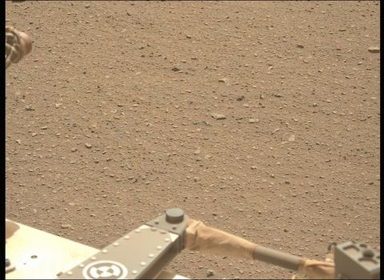

<b><bdi>Jezero floor unit (Njf)</bdi></b> · زەوییەکی تەخت کە بە چەوی بچووک داپۆشراوە، لە شوێنی جێهێشتنی لوولە بەردییەکانی <bdi>Three Forks</bdi> (<bdi>zone Z1</bdi>). بەشێک لە ڕۆبۆتەکە لە خوارەوەیە.

وێنەی ڕاستەقینە · <bdi>Left Mastcam-Z camera</bdi> · <bdi>sol 670</bdi> · <bdi>NASA/JPL-Caltech/ASU</bdi>

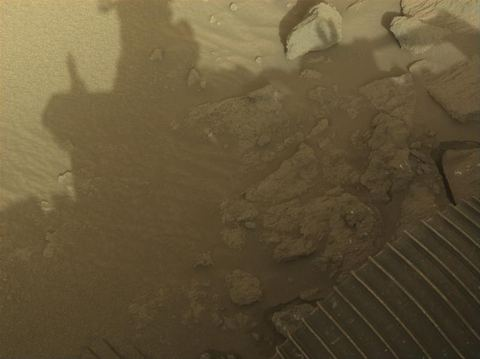

<b><bdi>Jezero fan 2 unit (NHjf2)</bdi></b> · بەردی شکاو لە تەنیشت تایەی ڕۆبۆتەکە، لە وێستگەی <bdi>sol 1159</bdi> (<bdi>zone Z2</bdi>). سێبەری ڕۆبۆتەکە دەبینیت.

وێنەی ڕاستەقینە · <bdi>Left Navigation Camera (Navcam)</bdi> · <bdi>sol 1159</bdi> · <bdi>NASA/JPL-Caltech</bdi>

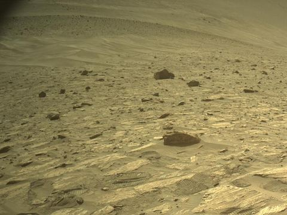

<b><bdi>Upper etched unit (Nue)</bdi></b> · بەردێکی تەخت و ڕەنگ‌کاڵ کە بەردی تاریکی لەسەرە، لە وێستگەی <bdi>Cheyava Falls</bdi> (<bdi>zone Z2</bdi>).

وێنەی ڕاستەقینە · <bdi>Left Navigation Camera (Navcam)</bdi> · <bdi>sol 1210</bdi> · <bdi>NASA/JPL-Caltech</bdi>

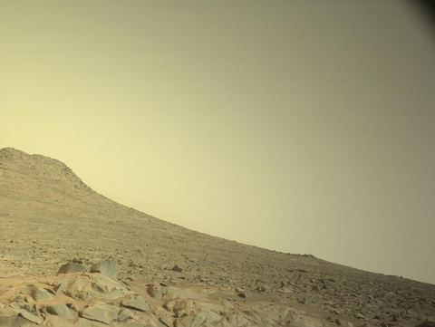

<b><bdi>Nili Planum 1 unit (Nnp1)</bdi></b> · لای گردێکی بەرداوی، لە وێستگەی <bdi>sol 1254</bdi> (<bdi>zone Z2</bdi>).

وێنەی ڕاستەقینە · <bdi>Left Navigation Camera (Navcam)</bdi> · <bdi>sol 1254</bdi> · <bdi>NASA/JPL-Caltech</bdi>

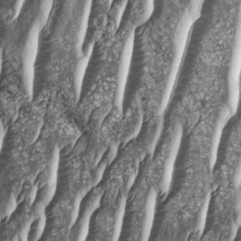

<b><bdi>Eolian bedform unit (Aeb)</bdi></b> · شەپۆلۆکەی لم کە لە بۆشایی ئاسمانەوە دەبینرێن، لە <bdi>Bright Angel</bdi> (<bdi>zone Z2</bdi>). پانیی وێنەکە نزیکەی 150 مەترە، و باکوور بەرەو سەرەوەیە.

وێنەی ڕاستەقینە · کامێرای <bdi>HiRISE</bdi> لەسەر <bdi>Mars Reconnaissance Orbiter</bdi> · <bdi>NASA/JPL-Caltech/University of Arizona</bdi> (<bdi>HiRISE</bdi>)، <bdi>via Mars Trek (R1)</bdi>

وێنەکانی ڕۆبۆتەکە زەویی نزیک هەر وێستگەیەک پیشان دەدەن. سنوورەکانی سەر نەخشەی بەرد دەکرێت <b>100 تا 200 مەتر</b> لە شوێنی ڕاستی خۆیان لایان دابێت (<bdi>USGS</bdi> خۆی وا دەڵێت)، بۆیە وێنەیەک کە نزیکی سنوورێکە لەوانەیە زەویی دراوسێ پیشان بدات.

> 📱 <b>لە ئەپەکەتدا</b>
>
> تابی <b><bdi>Layers</bdi></b> بکەرەوە و <b>«<bdi>Rock types</bdi>»</b> هەڵبژێرە. پاشان ماوسەکەت ببە سەر نەخشەکە: هێڵە نووسینەکەی خوارەوەی نەخشەکە ناوی جۆری ئەو بەردە دەڵێت کە لە ژێر ماوسەکەتدایە.

[↑ هەموو پرسیارەکان](#ku-toc)

---

<b>هەموو وێنە کێشراوەکانی ئەم پەڕەیە کارتۆنن و بە یارمەتیی یاریدەدەرێکی AI (<bdi>Claude</bdi>، هی <bdi>Anthropic</bdi>) بۆ ئەم ڕاپۆرتە کێشراون، و هەر یەکەیان نیشانەیەکی بچووکی <bdi>Made with AI</bdi>ی لەسەرە.</b> وێنەی ڕاستەقینە و داتای نەخشە نین. دەقەکان و وەرگێڕانە کوردییەکەش بە یارمەتیی هەمان یاریدەدەری AI نووسراون. <b>وێنەکانی وەڵامەکانی 5 و 6 و 7 و 17 ڕاستەقینەن:</b> وێنەی پەڵە پڵنگئاساکان (وەڵامی 5)، دوو وێنەکەی لوولەکان (وەڵامی 6 و 7) و چوار لە پێنج وێنەکەی وەڵامی 17 هی ڕۆبۆتی <bdi>Perseverance</bdi>ن (<bdi>NASA/JPL-Caltech</bdi>؛ ئەوەی <bdi>Mastcam-Z</bdi> هی <bdi>NASA/JPL-Caltech/ASU</bdi>ـە)، و یەکێکیان هی کامێرای <bdi>HiRISE</bdi>ـە لە خولگەی دەوری <bdi>Mars</bdi>دا (<bdi>NASA/JPL-Caltech/University of Arizona</bdi>، <bdi>via Mars Trek</bdi>). پڵنگەکە و مووەکەی لە وەڵامی 5دا یەک وێنەی پڵنگێکی ڕاستەقینەی سەر زەوین، هی <bdi>Charles J. Sharp</bdi> (<bdi>CC BY-SA 4.0</bdi>، <bdi>via Wikimedia Commons</bdi>)، تەنها بۆ بەراوردکردنی پەڵەکان دانراون: هی <bdi>NASA</bdi> نین و داتای نەخشە نین. داتا ڕاستەقینەکانی ناو ئەپەکە هی <bdi>NASA</bdi> و <bdi>JPL</bdi> و <bdi>USGS</bdi> و <bdi>NOAA</bdi>ن: <bdi>Mars Trek (R1)</bdi>، <bdi>USGS geologic map SIM 3464 (R2)</bdi>، <bdi>Perseverance raw images (R5)</bdi>، شوێنەکانی <bdi>rover</bdi> (<bdi>S1</bdi>)، کەشوهەوای بۆشایی ئاسمانی <bdi>NASA DONKI</bdi> (<bdi>S3</bdi>)، وێستگەی کەشوهەوای <bdi>rover</bdi> (<bdi>S4</bdi>) و داتای خۆری <bdi>NOAA GOES</bdi> (<bdi>S7</bdi>).

فۆنتەکان: <bdi>Playpen Sans Arabic</bdi> و <bdi>Vazirmatn</bdi>، بە مۆڵەتی <bdi>SIL Open Font License 1.1</bdi>.

بارامگەڕ · <bdi>Marswalk planner</bdi> · وەڵامەکان یەکەمجار لە چاتدا نووسران، 14 و 15ی تشرینی دووەمی 2026.

