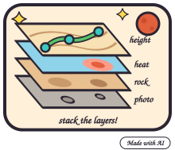
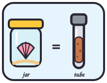
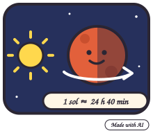

<b>English</b> · <a href="README.ckb.md">کوردی</a>

# Mars, like I'm five

Baramger · Marswalk planner

First, two big stories: the NASA challenge and our app. Then twelve easy answers about the Baramger map: the robot, the rocks, the crew, the house on Mars and the colours on the map.

**2 big stories** · **12 questions** · **simple English** · **cartoon drawings**

> 🖍️ **This is the GitHub copy.** GitHub can't show the cartoon page itself. For the full design and the **English | کوردی** button, download [`Baramger-Like-Im-Five.html`](../Baramger-Like-Im-Five.html) and open it in a web browser.

## Start here: the big picture

- **A** · [What is the NASA challenge?](#challenge)
- **B** · [What is our app, Baramger?](#app)

## Pick a question

- **1** · [The dashed white lines](#lines)
- **2** · [What is Perseverance?](#perseverance)
- **3** · [Why do we need this challenge?](#why)
- **4** · [Who is the crew?](#crew)
- **5** · [Cheyava Falls](#cheyava)
- **6** · [The little rock tubes](#tubes)
- **7** · [Three Forks](#threeforks)
- **8** · [Bright Angel](#brightangel)
- **9** · [Jezero crater](#jezero)
- **10** · [What is a sol?](#sol)
- **11** · [The Habitat](#habitat)
- **12** · [The red and yellow areas](#colours)

---

## A. What is the NASA challenge?

One day, people will walk on Mars. NASA asks: **"Can you make the map they will need?"**

When you go somewhere new, you need a good map. Mars is far away and dangerous: there is no air to breathe, it is very cold, and there are rocks and dust everywhere. So the astronauts need a **very, very good map**.

### What is wrong with the maps we have now?

NASA has sent robots to Mars for many years. They took **lots of pictures** and **lots of measurements**.

But all this information is in many different places, like toys spread all over a big room. And the maps we have now show **the whole planet** or **big areas**. An astronaut on a walk needs a map of **one small place**: "Where do I walk today?"

### What does NASA want us to build?

A map or a tool that helps an astronaut do a **Marswalk** (a walk on Mars, in a spacesuit). It should:

1. **Pick a place** on Mars. A place where robots already looked is easiest, because there are many pictures of it.
2. **Pick a science job**, for example "Go and look at these special rocks."
3. **Stack layers**, like see-through stickers on one picture: photos from space, how high or low the ground is, how hot or cold it is, what kind of rock is there, and space weather (the Sun can send out dangerous rays). NASA suggests **at least three kinds**.
4. **Show a safe path**: around big rocks, and not up hills that are too steep. Remember that the spacesuit is heavy and the astronaut carries tools.
5. **Show what it will look like.** Use the robot's photos from the ground, so the astronaut thinks: "Oh, I have seen this place before!"

> 💡 **NASA's number one rule**
>
> **Safety first.** The map must help the astronauts **come home safe**.

### Where can the map be?

We can choose. NASA gives some ideas:

- a **big screen inside the home base** (the Habitat, [question 11](#habitat)), to plan the walk
- a **tablet** the astronaut carries
- a small screen **inside the helmet glass**

### The five helpers NASA gives us

NASA also gives five "helpers": places full of information.

- **R1** · **Mars Trek** (JPL): a big picture book of Mars, seen from space.
- **R2** · **Geologic maps** (USGS and NASA): a colouring map that shows the kinds of rock.
- **R3** · **Curiosity's route map**: a path drawn for another robot, on another part of Mars. Good for ideas, not map data.
- **R4** · **NASA Worldview**: a map of Earth. Good for ideas only. It is **not Mars**!
- **R5** · **Perseverance raw images**: over a million photos taken on the ground by the robot.

> 📱 **In one sentence**
>
> Take NASA's many Mars pictures and measurements, stack them into **one smart map of one small place**, and help an astronaut plan and finish a **safe walk** there to do science.

[Question 3](#why) tells why we need people, not only robots. [Story B](#app) shows what we built.

[↑ back to the list](#start)

---

## B. What is our app, Baramger?

**Baramger is a helper app for astronauts on Mars.**

Two astronauts want to go for a walk on Mars to do science. Baramger helps them **plan** the walk, **walk** it safely, and **remember** it afterwards.

> 💡 **Why "Baramger"?**
>
> It is a Kurdish word made of two parts: **Baram** (بارام), an old name for the planet Mars, and **-ger** (گەڕ), "one that browses and explores", like وێبگەڕ (a web browser). So **Baramger** (بارامگەڕ) means "the Mars browser": a place to explore Mars.

### Where is the walk?

In **Jezero crater** ([question 9](#jezero)), a big round hole on Mars that was a lake long, long ago. The robot Perseverance ([question 2](#perseverance)) drives there now, so we have lots of photos of this place.

You can pick one of **two walks**:

> #### Walk Z2: Bright Angel
>
> **The job:** look at the rock with leopard spots ([Cheyava Falls](#cheyava)).
>
> **How long:** about 3 km, almost 4 hours with the stops.
>
> **How hard:** some steep hills.

> #### Walk Z1: Three Forks
>
> **The job:** pick up the [10 rock tubes](#tubes) the robot left on the ground.
>
> **How long:** about 1 km, a bit more than 2 hours with the stops.
>
> **How hard:** mostly flat and easy.

### The app, step by step

1. **Hello, Mars!** The app starts with a little show: a telescope on Earth finds Mars, and you fly to it. You see the whole planet and can spin it. The walk places are marked: click one, and you fly there.
2. **Plan the walk**, inside the Habitat, the evening before. A big **3D map** has layers, like a cake: photos from space, steep ground ([question 12](#colours)), kinds of rock, and the robot's path ([question 1](#lines)). Each stop has **real robot photos**, so the astronauts know what they will see. Then the app finds the **safest path**, like a map app in a car that goes around holes and steep hills.
3. **Safety check.** Before they go, the app asks many questions, like a careful parent (see the list below).
4. **Practice first.** The astronauts can watch a pretend walk on the map before the real one.
5. **The walk, with a tablet on the arm.** It says which way the next stop is and how far. It warns: "Careful! Steep ground ahead." "Sunset soon." "No radio here." If something goes wrong, they press **Head home**, and the app finds a new way home.
6. **The walk, inside the helmet.** A tiny screen in the helmet glass shows only the most important things: the next stop, the time left, the radio, and one warning at a time.
7. **After the walk.** Back home, the app plays the walk again like a movie, shows "what we planned" next to "what really happened", and makes a **report**. Then **Send to Earth** shows how long the message needs to get there: about **11 minutes** on 14 November 2026. It changes every day, from about 3 to 22 minutes, because Earth and Mars move around the Sun.

### The safety check asks…

- Is there **enough time** to come home, with extra time to spare?
- Is any hill **too steep**?
- Can the astronauts always **talk by radio** to the Habitat?
- Will they be back **before dark**?
- Is the **Sun calm** today, or is it sending out dangerous rays?
- Are their bags **too heavy**? Heavy bags make walking slower.
- Do they always walk **together**? That is the buddy rule ([question 4](#crew)).

### Fun extras

- **A size card.** A little card on the map shows how big things are: a person, the robot, a spaceship, a space station. When you zoom, the drawing changes.
- **Two planet looks.** "Height colours" (blue means low ground, not water!) or "natural colour" (close to the real colours of Mars, but not exact).
- **Real place names.** Ten official names from the USGS rock map, like Jezero and Neretva Vallis.
- **No internet needed.** Everything is inside the app. Good, because Mars has no Wi-Fi!

### Where does the information come from?

From **real NASA data**, mostly the five helpers from [story A](#challenge): space photos and height maps (R1), rock maps and place names (R2), and the robot's photos from the ground (R5). There is also some real extra data: the robot's path (S1), its weather station (S4), and Sun measurements from NOAA, made near Earth (S7).

> 📝 **One honest note**
>
> Nothing is made up. When we had to **guess** something, like how fast a person walks in a spacesuit, the app **says it is a guess**. And in this demo, the walk plays fast, like a time-lapse video, and "Send to Earth" saves the report as files instead of really sending it.

> 📱 **In one sentence**
>
> Baramger is a **smart map** that helps two astronauts plan a walk on Mars, walk it safely with a tablet and a helmet screen, and tell Earth what they found.

[↑ back to the list](#start)

---

## 1. What are those dashed white lines?

The dashed white line is **the path the Perseverance rover really drove**.

Think of it like footprints in the sand. The rover is a robot car on Mars. It drove here before, and the app draws its tracks as that white dashed line.

- **Why does it go through the numbered circles?** In zone Z2, stops 1, 3 and 4 are called "Rover stop, sol …". They are places where the rover parked, so they sit on its path. ("Sol" means a Mars day.)
- **It is not the walking path for the astronauts.** Before you plan, the panel says "no route yet". When you press **Find safest route**, a new line appears for the astronauts. It is green on easy ground and yellow where they must take care. Parts of that line are dashed too, but only where there is no radio.
- **Where does it come from?** NASA/JPL's list of rover positions (extra source S1).
- **Can I hide it?** Yes. Open the **Layers** tab and switch off **"Perseverance path"**.

[↑ all questions](#toc)

---

## 2. What is Perseverance?

**Perseverance is a robot car that NASA sent to Mars.**

- **How big is it?** About as big as a real car. It has six wheels.
- **Who drives it?** Nobody sits inside. People on Earth send it a list of moves, and the robot does them on its own.
- **When did it get there?** It landed on Mars in February 2021, inside a big hole called **Jezero crater**. Your app shows this same place.
- **Why is it there?** A very long time ago, Jezero crater was a lake full of water. Where there was water, there might have been tiny living things. Perseverance is looking for signs of them.
- **What can it do?**
   - It has **cameras**, like eyes. It takes lots of pictures.
   - It has a **robot arm**, like a hand. It can touch rocks and look at them closely.
   - It has a **drill**. It can cut a small piece of rock and keep it in a little tube, like putting a treasure in a jar.

> 📱 **In your app**
>
> - The **white dashed line** shows where it drove.
> - The **"Rover stop" circles** are places where it parked.
> - The **photos** in your app are its real pictures (resource R5).
> - **Cheyava Falls** (stop 2 in zone Z2) is a rock it found in 2024. The rock has small spots, like a leopard's spots, and scientists want to know if they came from tiny living things.
> - **Three Forks** (zone Z1) is where it left 10 of its rock tubes on the ground. A future mission could come and pick them up.

[↑ all questions](#toc)

---

## 3. A robot is already there. Why do we need this challenge?

The robot is great, but it is **slow**.

- **It waits for Earth.** People on Earth tell the robot what to do. A message takes many minutes to reach Mars, so the robot often waits for its next order.
- **It moves slowly.** It drives very carefully, so one short trip can take days.
- **It can't really think on the spot.** A person can look at a rock, say "Ooh, that one looks odd!", walk over, and turn it around, all in a few minutes.

So NASA asks: **"One day, people will walk on Mars. How do we help them walk safely?"**

People are not robots. They need air to breathe, they get tired, they carry heavy bags, and they must get home before dark. The challenge asks for a **map made for people**: a map that shows the safe way to walk, where the radio works, and when the weather or the Sun could be dangerous.

[↑ all questions](#toc)

---

## 4. What is meant by "crew" in the project?

**The crew is the team of astronauts going on the walk.**

In your app, the crew has **2 astronauts**. They always walk together, like holding hands when crossing the street. That way, if one gets hurt, the other can help. This is called the **buddy rule**.

They live in the **Habitat**, the "H" on the map. It is their little house on Mars. They leave it in the morning, visit the stops, and come back home.

[↑ all questions](#toc)

---

## 5. What is Cheyava Falls?

**Cheyava Falls is a special rock on Mars.**

- **Where is it?** In a dry old river valley. Long ago, water flowed there. It is stop 2 on the Bright Angel map.
- **Where does the name come from?** NASA named it after a waterfall in the Grand Canyon on Earth.
- **How big is it?** About as big as a small table, and shaped a bit like an arrowhead.
- **Why is it special?** It has **tiny spots, like a leopard's spots**: small light dots with dark rings around them.
- **Why do the spots matter?** On Earth, spots like these can be made by **tiny living things**, too small to see. So scientists asked, "Did tiny living things make these spots on Mars long ago?"
- **What did the robot do?** It drilled a small piece of the rock and saved it in a tube.
- **What do we know now?** In 2025, NASA said this piece is **one of the best clues so far** that life might once have been on Mars. But it is **not proof**. The spots could also have been made without anything living.

> 📱 **In your app**
>
> That is why your app plans a walk there. A person could look at the rock from every side, check the rocks nearby, and choose the best piece to bring back to Earth.

[↑ all questions](#toc)

---

## 6. What are the robot's little rock tubes?

### The robot collects rocks, like you collect shells at the beach

Picture yourself at the beach. You find a pretty shell and want to take it home. So you:

1. **Pick it up.**
2. **Put it in a small jar.**
3. **Close the lid tight**, so it doesn't fall out or get dirty.

The robot does the same thing on Mars:

1. **It drills a tiny piece out of a rock.** The piece is about as big as a piece of chalk.
2. **It puts the piece into a small metal tube.** That tube is the "jar".
3. **It closes the tube with a lid**, so no dust or air gets in.

### Why does it keep the rocks?

The robot has some tools to look at rocks. But on Earth, scientists have **huge, powerful machines**, much too big to fit on the robot. Those machines can see far more.

So the plan is: **keep the rocks in the tubes now, and fly them to Earth one day**, so scientists can look at them with the big machines.

> 📱 **How this fits Three Forks**
>
> Most of the tubes are still **inside the robot**. But the robot put **10 of these closed tubes on the ground at Three Forks**, like leaving some shell jars in a safe place. In your app, the astronauts walk there and pick them up.

[↑ all questions](#toc)

---

## 7. What is Three Forks?

**Three Forks is a place on Mars where the robot left a "treasure box" on the ground.**

Remember the robot's little rock tubes from question 6, the "jars" with rock pieces inside?

- The robot kept many tubes **inside its body**.
- But it made **copies** of some of them, and it put **10 tubes on the ground** at Three Forks. This happened at the end of 2022 and the start of 2023.
- It did not put them all in one pile. It put them **far apart, one by one, in a long zig-zag line**, like leaving cookies along a path.

### Why leave them on the ground?

**It is a backup**, like keeping a spare key under the doormat.

If the robot breaks one day, the tubes inside it are stuck. But the 10 tubes on the ground are still safe. Later, a new mission can come, **pick them up, and bring them to Earth**. Nobody has picked them up yet. They are still lying there today.

The robot spread them apart so that if one spot has a problem (like dust covering it), the other tubes are still okay.

> 📱 **In your app**
>
> It is **zone Z1**. It has **10 stops**, one for each tube.
>
> The crew walks from tube to tube and **picks them up**. The app counts as they go: "tubes picked up 1 of 10, 2 of 10…". It is like an Easter egg hunt on Mars!

> 📝 **One honest note**
>
> We don't know the exact spot of each tube. The app puts each stop where the robot **parked** when it dropped that tube. That is a good guess, but only a guess, so the project marks it **"to check"** (assumption A14).

[↑ all questions](#toc)

---

## 8. What is Bright Angel?

**Bright Angel is a small area on Mars, inside the big Jezero crater.**

Think of a big park. Jezero crater is the **whole park**. Bright Angel is **one corner of the park**. Cheyava Falls, the spotted rock, is **one special rock in that corner**.

### Why is it called "Bright Angel"?

- **"Bright"**: many rocks there are **light-coloured**, paler than the dark ground around them, so they look bright.
- **The name** comes from a creek and trail in the **Grand Canyon** on Earth. NASA likes to name places on Mars after places on Earth, like calling a new friend after someone you know.

### What is special there?

- Long ago, a **river** flowed through this spot. Today it is dry, but the river cut a valley, like a slide carved in the ground.
- Where water was, there might have been **tiny living things**.
- The robot drove there in **2024** and found the **Cheyava Falls rock** with its leopard spots.

> 📱 **In your app**
>
> It is **zone Z2**, the main zone of your project. It has **4 stops**:
>
> 1. **Rover stop, sol 1159**: a place where the robot parked
> 2. **Cheyava Falls rock**: the spotted rock
> 3. **Rover stop, sol 1231**: another parking place
> 4. **Rover stop, sol 1254**: another parking place
>
> The crew leaves the **Habitat (H)**, walks to these stops, looks closely at the spotted rock, and comes home safely. The app finds the safest path for them.

[↑ all questions](#toc)

---

## 9. What is Jezero crater?

**Jezero crater is a giant round hole on Mars, shaped like a bowl.**

### How was it made?

Have you ever thrown a stone into sand? It leaves a little round hole.

A very long time ago, **a big rock from space crashed into Mars**. It made a hole, but a **huge** one. It is so wide that a grown-up walking all day long could not cross it. That hole is Jezero crater.

### Why is it special?

Long, long ago, Mars was wetter than today.

1. **The bowl filled with water** and became a **lake**, like rain filling a bucket.
2. **A river flowed into the lake.**
3. The river carried **sand and mud**. Where it met the lake, it dropped them in a **fan shape**. It is like pouring water from a cup into a sandbox: the mud spreads out like a fan.

Today the water is gone. But the fan of mud is still there, turned into rock.

Where there was water, there might have been **tiny living things**. So NASA thought, "This old lake is a great place to look for clues!" That is why the robot **Perseverance landed here in 2021**.

### Where does the name come from?

It is named after a small town on Earth, in a country called Bosnia and Herzegovina. In that country's language, **"jezero" means "lake"**. A good name for an old lake!

> 📱 **In your app**
>
> Jezero crater is **the whole playground**. Both of your walking zones are inside it:
>
> - **Three Forks (Z1)**: where the robot left the 10 rock tubes
> - **Bright Angel (Z2)**: where the spotted Cheyava Falls rock is
>
> In the app, you can zoom out to see the **whole crater** with both zones marked, and zoom out more to see **all of Mars**.

[↑ all questions](#toc)

---

## 10. What is a sol?

**A sol is one day on Mars.**

### What is a day?

A day is the time from **one morning to the next morning**. It happens because the planet **spins around like a top**. When your side faces the Sun, it is daytime. When it turns away, it is night.

- **Earth** takes **24 hours** to spin around once.
- **Mars** spins a little more slowly. It takes about **24 hours and 40 minutes**.

So a Mars day is **about 40 minutes longer** than an Earth day. That is a bit more time to play!

### Why a special word?

If someone says "3 days", you might ask, "Earth days or Mars days?" To avoid mixing them up, scientists call a Mars day a **"sol"**. It comes from "Sol", an old name for the Sun.

### How does the robot count sols?

Like counting how many days old a baby is:

- The day the robot **landed** on Mars is **sol 0**.
- The next Mars day is **sol 1**, then **sol 2**, and so on.

So **"sol 1159"** means "the robot's **1159th day** on Mars". That is a bit more than **3 Earth years** after it landed, around the middle of 2024.

> 📱 **In your app**
>
> On your map, **"Rover stop, sol 1159"** means "**the robot parked here on its 1159th Mars day**". The sol numbers tell you **when** the robot was at each spot.

> 💡 **Fun fact!**
>
> When the robot first landed, some NASA workers on Earth lived on **Mars time**. Every day, they came to work about 40 minutes later than the day before, so their days matched the robot's sols!

[↑ all questions](#toc)

---

## 11. What is the Habitat?

**The Habitat is the astronauts' house on Mars.** On your map, it is the circle with the letter **"H"**.

### Why do they need a house?

Mars is **not a friendly place** for people:

- It is **very, very cold**, much colder than a freezer.
- The air is **too thin to breathe**.
- The Sun sends out **invisible rays** that can hurt people.

Outside, the astronauts must wear **big spacesuits**, like a tiny house you wear on your body. Inside the Habitat they are safe. They can take off their suits, breathe, eat, sleep and stay warm.

### What does the Habitat do in your app?

1. **The walk starts and ends there.** The crew leaves the "H" in the morning, visits the stops, and must **come home before it gets dark** and before their air runs low. The app checks this for them.
2. **It is where they plan.** The Plan screen is like a tablet the crew uses **inside the Habitat the day before**: "Tomorrow, where do we go? Is it safe?"

### How did the app choose where to put it?

This is the clever part. The app looked for a spot with two things:

1. **Flat ground**, so the house doesn't tip over, like building a sandcastle on flat sand, not on a slope.
2. **A good radio connection to the walking path.** The radio lets the astronauts talk to their friends at home. Radio is like a flashlight beam: it goes in straight lines, and **hills block it**, like when you hide behind a wall in hide-and-seek.

At first, the app picked just the flattest spot. But from there, hills blocked the radio for most of the walk: for **79 of the 90 minutes**, nobody could talk to home. So now the app picks a place that is **flat enough AND can "see"** as much of the path as possible.

> 📝 **One honest note**
>
> **There is no real house on Mars yet.** No person has ever been there. The Habitat in your app is **pretend**, a plan for the future. The project marks its spot as a guess to check later (assumption **A6**).

[↑ all questions](#toc)

---

## 12. What are the red and yellow areas?

**They show where the ground is steep, like the side of a hill.** On your map, this layer is called **"Steep ground"**.

### What does "steep" mean?

Think about the ground like this:

- **A floor** is flat. Walking is easy.
- **A hill** is tilted. Walking is harder.
- **A playground slide** is very tilted. You could easily slip.

The more tilted the ground, the harder and more dangerous it is to walk on.

### What do the colours mean?

It works like a traffic light:

- ⬜ **No colour (just grey rock):** gentle ground. **Walk normally.**
- 🟨 **Yellow:** steep, like a big hill. **Be careful and go slowly.** (15 to 25 degrees)
- 🟥 **Red:** very steep, almost like stairs or a slide. **Don't go there!** (more than 25 degrees)

### Why is steep ground dangerous on Mars?

The astronauts wear **big, bulky spacesuits**:

- It is hard to **see your own feet** in the suit.
- The suit makes it hard to **bend and keep your balance**.
- Sand and small stones can **slide under your boots**.
- If you fall, your suit could **get torn**, and the suit holds the air you breathe.

### How does the app use the colours?

When you press **"Find safest route"**, the app finds the path for the astronauts:

- It **never walks through red**. It goes around, like walking around a puddle.
- On **yellow**, it walks **slower**, so the app gives yellow parts **more time** (about one and a half times longer).

### Where do the colours come from?

From a very detailed **height map** of Mars made by a camera on a spaceship flying around Mars (from Mars Trek, resource **R1**). The app checks how tilted each tiny piece of ground is, about every 2 steps.

To make sure the map tells the truth, the project compared it with the **robot's own tilt** at 79 places where it really parked. They matched closely, off by only about **2 degrees** on average.

> 📱 **In your app**
>
> You can switch the colours on or off in the **Layers** tab.

[↑ all questions](#toc)

---

**All drawings on this page are cartoons made for this report.** They are not photos and not map data. The real data in the app comes from NASA, JPL, USGS and NOAA: Mars Trek (R1), the USGS geologic map (R2), Perseverance raw images (R5), the rover positions (S1), the rover's weather station (S4) and NOAA Sun data (S7).

Baramger · Marswalk planner · answers first written in chat on 14 November 2026.

Drawings: each picture in `img/` is a cartoon made for this page. Text in the drawings uses a subset of Playpen Sans Arabic (SIL Open Font License 1.1).
