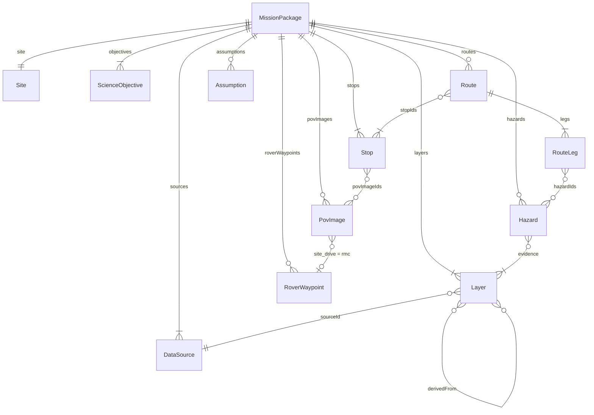

# Baroler data model

`marswalk.schema.json` (JSON Schema 2020-12) describes two kinds of documents:

| `kind` | File | Purpose |
|---|---|---|
| `source-registry` | `data/sources.registry.json` | Ledger of every data source + candidate layers, with verification status |
| `mission-package` | (later) `package/<site>/mission-package.json` | Everything the offline app needs for one Marswalk |

## Entities

## Conventions

- **CRS:** Mars 2000 sphere, R = 3,396,190 m, planetocentric latitude, east-positive longitude in [-180, 180].
- **Elevation:** metres above the MOLA areoid.
- **Geometry:** GeoJSON *shape*, Mars coordinates (not WGS 84). The package `crs` block says so.
- **Source IDs:** `R1`–`R5` = the five challenge resources. `S<n>` = supplementary, always `inResourceList: false`.

## Rules the schema enforces

1. Registry and package must list **all five** resources R1–R5 (`HasAllFiveResources`).
2. `R*` sources must have `inResourceList: true`; `S*` sources must have `false`.
3. A `derived` layer must have `derivedFrom` (≥ 1) and `process`.
4. A package has ≥ 3 layers, ≥ 1 objective, ≥ 2 stops.
5. Every `PovImage` comes from R5 and carries a `credit`.
6. Hazard messages are ≤ 60 characters (HUD-sized).

## Rules a later validator script must check (JSON Schema can't)

1. Every `layer.sourceId` exists in `sources`.
2. Every `derivedFrom`, `stopIds`, `hazardIds`, `povImageIds`, `objectiveIds`, `evidence.layerId` points to an existing ID.
3. Layers cover **≥ 3 distinct `dataKind`s** other than `derived`.
4. Every derived layer traces back (recursively) to at least one `R*` source.
5. Each of R1–R5 is **actually used** by at least one layer, image, or a documented design/UX role.
6. Any `S*` source is allowed only if decision D2 = yes.
7. Route legs connect stops in `stopIds` order, and `totals` equal the sum of the legs.
8. All positions lie inside `site.aoi`, and the AOI lies inside the HiRISE DEM coverage.
